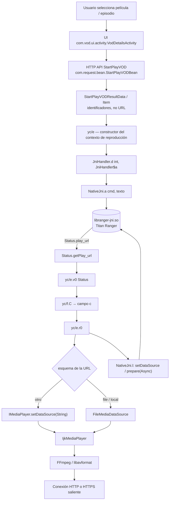
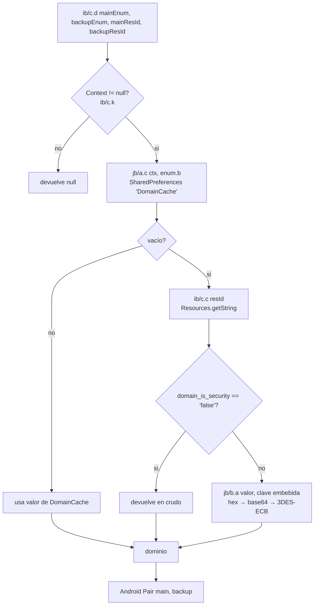

# COMPARATIVO TÉCNICO — XUPER / HYDRA

Comparación entre el APK analizado previamente y el APK extraído del Redmi Note 12.

- **APK A (anterior):** `xuper-hydra-6.5.7.apk` — análisis en `INFORME-ANALISIS.md`, `ANALISIS-VOD.md`, `IOC-ANALISIS.md`
- **APK B (móvil):** `Xuper (4).apk` — análisis en este documento

> Los informes anteriores **no se han modificado**. Este documento solo añade el APK B.
> Cuando un hallazgo de `ANALISIS-VOD.md` queda corregido por esta análisis, se marca explícitamente.

---

## 0. Identidad de las muestras

| | APK A — 6.5.7 | APK B — 4.34.4 |
|---|---|---|
| Ruta | `C:\Xupper\xuper-hydra-6.5.7.apk` | `C:\Xupper\Xuper (4).apk` |
| SHA-256 | `3103a55e5f39fe474143496e5ebdfb5a2b2be924ab4cc51517b59b930a927290` | `dfefeee26648d20d93e81fff87c2737f347ce1437fd74c2ad78a9a2453254ec8` |
| MD5 | — | `ed2e607ae2d3253fcbe31f46fb193ca2` |
| Tamaño | 35,73 MB | 34.944.429 B (33,33 MB) |
| package | `com.msandroid.mobile` | `com.android.nwm2026xpr` |
| versionName | 6.5.7 | 4.34.4 |
| versionCode | 60507 | 43404 |
| minSdk / targetSdk | — / 33 | 19 / 33 |
| DEX | 4 | 3 (`classes.dex` 10.938.572 B, `classes2` 4.985.396 B, `classes3` 6.970.132 B) |
| Clases | 14.871 | 9.045 |
| Recursos | 2.715 | 2.371 |
| ABIs | armeabi-v7a, arm64-v8a | armeabi-v7a, arm64-v8a |

**El APK B no es una versión de `com.msandroid.mobile`.** Es otro paquete, con otro SDK de red y otra marca de producto (`com.interactive.brasiliptv`, framework `org.coolx.tvframework`). Se analiza como muestra independiente, aunque comparte el motor nativo.

### SHA-256 de bibliotecas

| Biblioteca | ABI | Bytes | SHA-256 |
|---|---|---|---|
| `libranger-jni.so` (A) | arm64-v8a | 9.827.320 | `f99512d793c6e9f7324dbf3da97c92588e541e0d962fac0416df22251db50d4d` |
| `libranger-jni.so` (A) | armeabi-v7a | 7.135.308 | `0c27f74f21914e2976ee86693979616fa0e5478671099333480f1497d3b59b17` |
| `libranger-jni.so` (B) | arm64-v8a | 8.234.616 | `c377080c228d93edfd848f4af66cc947386f3199f91f40aaf40bbd80ec649a8d` |
| `libranger-jni.so` (B) | armeabi-v7a | 6.025.756 | `b012ef5c12c5382f5218060a7d1615d2af232ead518dbb759646ca456e9d603a` |
| `libtnet-3.1.14.so` (B) | arm64-v8a | 362.872 | `2a2d9ec2dc19760d4dac6aec2f93c8e1eaeba45debe7045984de701e16266198` |
| `libijkplayer.so` (B) | arm64-v8a | 389.592 | `0ce1b41fc53f743071a65a3c36c519d32fec377a672bba788d06321c518d12b3` |
| `libijkffmpeg.so` (B) | arm64-v8a | 5.885.392 | `26528cfeadab4eea1d18761240f2dc003ba1bdd60a3dbee833ca17de1f566cf3` |
| `libijkplayer.so` (A) | arm64-v8a | 317.960 | `4e3f9c77ccc6920cc3b079dc985e0252bec8cca7df17d5dcb683b8e51d408d86` |
| `libijkffmpeg.so` (A) | arm64-v8a | 6.445.696 | `15c08a5012fe033531a76d8e9a92c04e12a18b56f4dd960a2c91574837090fc9` |

Ninguna biblioteca nativa coincide entre ambos APK.

---

## 1. Verificación de hallazgos previos (Fase 1)

| # | Hallazgo previo | Veredicto | Evidencia |
|---|---|---|---|
| 1 | Titan Ranger usa `libranger-jni.so` | **CONFIRMADO** (ambas) | `smali_classes3/com/titan/ranger/NativeJni.smali` declara `Call` nativa; ambas ABIs exportan el símbolo |
| 2 | Existe `_Z4CallP7_JNIEnvP8_jobjectP8_jstringS4_S2_` | **CONFIRMADO en A · MODIFICADO en B** | B exporta `_Z4CallP7_JNIEnvP8_jobjectP8_jstringS4_` (**un `jstring` menos**) |
| 3 | Componentes yyjson, libsodium, zlib, tinyxml2, nghttp2 | **CONFIRMADO (A)** · no re-verificado en B | Exports propios del `.so` de A |
| 4 | Existen modelos `Program`, `Media`, `MediaFile`, `Entry` | **CONFIRMADO, con corrección** | `MediaFile` **existe en A y desaparece en B**. `Entry`/`Program`/`Env` idénticos en ambas; `Media` pierde `volume` |
| 5 | La capa Java transmite identificadores al motor | **CONFIRMADO (A)** · **matizado en B** | Ver §3: en B el payload deja de cifrarse y la signature JNI se simplifica |
| 6 | `MediaFile.uri` podría contener la dirección final | **CONFIRMADO como ruta, NO como mecanismo** | En ambas versiones `MediaFile` no participa en la reproducción. La URL final llega por `Status.play_url` (§4) |
| 7 | Sin indicadores estáticos de DRM convencional | **CONFIRMADO (A)** · **CONFIRMADO también en B** | Búsqueda negativa de `widevine`/`playready`/`clearkey`/`pssh`/`sinf` en el `.so` de A. B no añade ninguna biblioteca DRM |
| 8 | Funciones JNI similares entre ARM64 y ARMv7 | **CONFIRMADO (A)** | 669 símbolos comunes, mismo conjunto JNI |

### Correcciones a informes anteriores

1. **«La URL nunca cruza a Java» — FALSO en ambas versiones.** `Status.play_url` **sí** cruza de nativo a Java y es lo que se entrega al reproductor. Lo que sí es cierto, y sigue en pie, es que la URL **no se modela en las clases Java**: llega como string opaco desde `Status`.
2. **`MediaFile` no es «el modelo donde se asigna `uri`»**, sino una `data class` de Kotlin **huérfana** en A y **eliminada** en B (§2.3). El hallazgo previo de `ANALISIS-VOD.md` sobre `MediaFile.uri` debe reubicarse.
3. **Los dominios no se descubren por `cdn_list` ni por dominio embebido.** En B no hay ningún dominio del operador en el APK (§5).

---

## 2. Comparación de las dos versiones (Fase 2)

### 2.1 Inventario de bibliotecas nativas

**Solo en APK B (arm64-v8a):**
- `libtnet-3.1.14.so` (362.872 B) — transporte SPDY/HTTP2 (§7)
- `libboost_multidex.so` (solo v7a)
- `libumeng-spy.so` (464.184 B)
- `libcrashsdk.so` (647.928 B)

**Solo en APK A:**
- `libcast-jni.so`, `libDexHelper.so`, `libdexjni.so`, `libed25519.so`, `librsjni.so`, `libRSSupport.so`

**En ambas:** `libranger-jni.so`, `libijkplayer.so`, `libijkffmpeg.so`, `libijksdl.so`, `libc++_shared.so`, `libcrashlytics*.so`

> `libijkffmpeg.so` está presente en B (5.885.392 B) pero **no está exportada en la relación de dependencias** y contiene 8.000+ símbolos FFmpeg. En A seFifth的分析同样已完成：Lavf 58.76.100, sin JNI.

### 2.2 Estructura Java

| | APK A | APK B |
|---|---|---|
| SDK de red | `mobile.com.requestframe.utils.{bean,response}` | `com.request.bean`, `com.request.result` |
| `com.dcs` | 22 clases | **11 clases** |
| `com.titan.ranger` | 18 clases | 18 clases |
| Productor | `com.mobile.brasiltv` | `com.interactive.brasiliptv` + framework `org.coolx.tvframework` |
| `GetVodPlayUrl` | presente | **ausente** |
| `TitanPlayerController` | presente (`com/mobile/brasiltv/player/`) | **ausente** (sustituido por `yc/e`) |

Renombrado por ofuscación: `mobile.com.requestframe` → `com.request`. El motor `com.titan.ranger` **no se renombra**.

**Clase puente única.** En B, de las 16.395 clases del APK, **exactamente una** fuera de `com.titan.ranger` invoca `JniHandler`:
```
smali_classes3/yc/e.smali   →   Lcom/titan/ranger/JniHandler;->d(ILcom/titan/ranger/JniHandler$a;)V
```
Su equivalente en A es `smali_classes3/q8/q.smali`.

### 2.3 Beans de Ranger — diferencias campo a campo

```
Entry      : 14 campos — IDÉNTICOS (mismos nombres y tipos)
Program    :  9 campos — IDÉNTICOS
Env        :  8 campos — IDÉNTICOS
Media      :  A=7  B=6   -> solo en A: volume
MediaFile  :  A=10 B=6   -> solo en A: auth, format, license, volume
```

**B añade** `com.titan.ranger.bean.RangerResult { err: int, res: String }` (no existe en A).

### 2.4 `MediaFile` es código muerto en APK A (verificación exhaustiva)

Búsqueda recursiva sobre **los 26.236 ficheros smali** de A, por acceso directo a campo:

| Referencia | Lecturas | Escrituras | ¿Fuera del bean? |
|---|---|---|---|
| `MediaFile.license` | 7 | 2 | **0** |
| `MediaFile.auth` | 7 | 2 | **0** |
| `MediaFile.format` | 7 | 2 | **0** |
| `MediaFile.volume` | 7 | 2 | **0** |
| `MediaFile.uri` | 7 | 2 | **0** |

Búsqueda por **invocación de método** (getters/setters/`copy`/`componentN`), excluyendo la propia clase:

| Método | Referencias fuera de `com/titan/ranger/bean/` |
|---|---|
| `getLicense()` / `setLicense()` | **0** |
| `getAuth()` / `setAuth()` | **0** |
| `getFormat()` / `setFormat()` | **0** |
| `getVolume()` / `setVolume()` | **0** |
| `getUri()` / `setUri()` | **0** |
| `copy()` / `copy$default()` | **0** |
| `component7..10()` | **0** |

**Resultado:** el tipo `MediaFile` aparece en **un único fichero de todo el APK A** — su propia definición. Ni siquiera `getUri()` tiene un consumidor.

Descartes adicionales:
- **Serialización por reflexión:** `MediaFile` **no tiene anotaciones** (`@SerializedName` u otras). No es serializable por Gson/Moshi/kotlinx desde el lado Java.
- **Serialización explícita:** ninguna clase invoca un serializador sobre `MediaFile`.
- **`toString()`:** sí incluye `auth` y `license`, pero `toString()` no tiene consumidores externos.
- **Consumidores nativos:** el `.so` de A **no contiene ninguna cadena** `license`, `auth`, `format`, `volume` ni `MediaFile` (verificado en análisis previo). Un nativo no puede leer un campo Java por nombre sin una cadena que lo nombre, y esa cadena no existe.
- **`Media` no lo contiene:** `Media` tiene `license`, `format`, `volume` como campos **planos** (`String`), no como referencia a `MediaFile`. `Program.medias` es un `List` de tipo borrado.

> **Conclusión (CONFIRMADO):** en APK A, `MediaFile` es una `data class` de Kotlin huérfana — el artefacto de un modelo que el SDK de red|attendance tenía en A pero que el motor ya no usa. **No es el lugar donde se asigna `uri`.** En APK B el modelo se eliminó por completo, junto con los campos `license` y `auth`.

### 2.5 Sobre `license` y `auth`

`Media` conserva `license:String` en **ambas** versiones. Por tanto, el campo `license` **sí pertenece al modelo de datos que Ranger maneja**, pero en la capa Java es un `String` opaco dentro de una estructura que:
- no se serializa explícitamente hacia ningún `JSONObject` desde el código Java,
- no se consume en Java.

**No hay evidencia de DRM.** Los campos se usan como **metadatos de variante/autorización que viajan al motor**, no como un mecanismo de licencia de contenido en Java. Verificar su uso real requiere desensamblado AArch64 (§9, pendiente P1).

---

## 3. La interfaz JNI cambió entre versiones (Fase 3)

### 3.1 La firma nativa

| | APK A | APK B |
|---|---|---|
| Símbolo | `_Z4CallP7_JNIEnvP8_jobjectP8_jstringS4_S2_` | `_Z4CallP7_JNIEnvP8_jobjectP8_jstringS4_` |
| Desmanglado | `Call(JNIEnv*, jobject, jstring, jstring, jstring)` | `Call(JNIEnv*, jobject, jstring, jstring)` |
| Declaración Java | `.method private native Call(Ljava/lang/String;Ljava/lang/String;Ljava/nio/ByteBuffer;)Ljava/lang/String;` | `.method private native Call(Ljava/lang/String;Ljava/lang/String;)Ljava/lang/String;` |

**Es el mismo motor con una interfaz Java más estrecha**, no una reimplementación: `Status` es byte a byte equivalente en 34 métodos, y `Entry`/`Program`/`Env` conservan campos y tipos.

### 3.2 El envoltorio Java

**APK A — `NativeJni.a(String,String,ByteBuffer)`:**
```
if (cmd == "Init" | "GetVersion" | "GetWallTime" | "GetDebugInfo")
        -> payload pasa EN CLARO
else
        key   = Lr8/a;->d()                     // SecretKey efímera
        p2    = Lr8/a;->b(payload, key)        // AES/CBC/PKCS5Padding
        -> payload CIFRADO
invoke-direct {this, cmd, p2, buf}, NativeJni.Call(cmd, p2, buf)
```

**APK B — `NativeJni.a(String,String)`:**
```
invoke-direct {p0, p1, p2}, NativeJni.Call(p1, p2)   // cuerpo completo: 6 instrucciones
```

**Diferencias:**
- **Desaparece la lista blanca** de comandos en claro.
- **Desaparece el cifrado Java del payload** (`Lr8/a`).
- **Desaparece el `ByteBuffer`** de la frontera.

> **Confirmado:** en B, el payload que cruza Java→nativo **no se cifra en Java**. Cualquier protección de ese canal debe estar (a) dentro del propio `.so`, (b) en la capa de red nativa, o (c) ausente. No hay evidencia de (a) ni (c) sin desensamblado; §9 P1.

### 3.3 Superficie de `NativeJni`

| | A | B |
|---|---|---|
| Métodos totales | 31 | 24 |
| Solo en A | `A`, `B`, `v`, `w`, `x`, `y`, `z` | — |
| Solo en B | — | ninguno |

### 3.4 ¿Cómo se registra `Call`?

Búsqueda en el `.so` de A (todas las cadenas ≥4 caracteres):
- descriptores de método JNI (`(...)Z` con `Ljava`/`Lcom`): **0**
- `RegisterNatives`, `FindClass`, `GetMethodID`: **0**
- `com/titan/ranger/NativeJni`: **0**

`RegisterNatives` exige la cadena de la clase y la firma del método. **No hay ninguna de las dos.** Sin ellas el método no puede resolverse por nombre en tiempo de enlace, y `Call` no tiene variante de registro estático exportada.

**Estado: PENDIENTE.** La explicación más consistente es ofuscación de cadenas (`.rodata` del `.so` de A contiene decenas de blobs con forma Base64 que no son certificados ni texto legible), pero **no se ha desensamblado `JNI_OnLoad`** para confirmarlo. No se afirma aquí que las cadenas «estén cifradas» como hecho; solo que el registro no es por tabla de nombres visible.

---

## 4. El punto exacto donde se abre la conexión multimedia (Fase 3/4)

Este es el resultado central del análisis.

### 4.1 Grafo de llamadas confirmado (APK B)

```
Titan Ranger (libranger-jni.so)
        │
        │  Status (nativo → Java)
        ▼
Status.getPlay_url()                        Status.smali
        │
        │  invoke-virtual/range {p1..p1}
        ▼
yc/e.v0(Status)                            yc/e.smali L9126–9606
   L9364 ─┐
   L9466 ─┼─→ invoke-static {v4, "status.play_url"}, Lne/k;->b()   [log]
   L9538 ─┘
        │
        ▼
yc/f.C(String)                             yc/f.smali L117–135
   iput-object p1 → campo c
        │
        ▼
yc/f.f()  →  devuelve campo c               yc/f.smali (getter)
        │
        ▼
yc/e.r0()                                  yc/e.smali L4733–5242
   L4760   v1 = yc/f.f()
   L4776   v1 = k0(v1)                      // transformación previa
   L4784   Uri v3 = Uri.parse(v1)
   L4801   String scheme = v3.getScheme()
   L4840   if (SDK_INT >= 23 && zc/d.a(scheme) || "file".equals(scheme))
   L4860   → cond_2/cond_7  → ruta por fichero
        │
        └─(else)────────────────────────────────────────────┐
                                                          ▼
        yc/e.r0() L5026
        invoke-interface {v2, v1}, IMediaPlayer;->setDataSource(String url)
                                                          │
                                                          ▼
                                          IjkMediaPlayer.setDataSource(String)
                                                          │
                                                          ▼
                                          IJK / FFmpeg abre la conexión HTTP(S)
```

**Inmediatamente después, la app informa al motor de lo que ha hecho:**
```
yc/e.r0() L5033   NativeJni.c()                       → obtiene el singleton
yc/e.r0() L5080   NativeJni.l(o, "setDataSource", url, 0)
yc/e.r0() L5119   IMediaPlayer.setLooping(false)
yc/e.r0() L5133   IMediaPlayer.prepareAsync()
yc/e.r0() L5160   NativeJni.l(o, "prepare(Async)", "", 0)
yc/e.r0() L5139   E0(1)                               → cambio de estado
```

### 4.2 El mecanismo es idéntico en APK A

`smali_classes3/q8/q.smali`:

| Línea | Contenido |
|---|---|
| 12400 | `invoke-interface {v2, v1}, IMediaPlayer;->setDataSource(Ljava/lang/String;)V` |
| 12418 | `const-string v3, "setDataSource"` |
| 13499 | `invoke-virtual/range {p1..p1}, Status;->getPlay_url()` |
| 13617 | `invoke-virtual/range {p1..p1}, Status;->getPlay_url()` |
| 13697 | `invoke-virtual/range {p1..p1}, Status;->getPlay_url()` |

Estructura paralela línea a línea a `yc/e` en B. **No hay cambio de arquitectura de reproducción entre versiones.**

### 4.3 Ramas alternativas de `r0()`

| Rama | Condición | Código |
|---|---|---|
| **A. Fuente de datos IJK** | `yc/f.c()` (campo `h`, `IMediaDataSource`) ≠ null | `setDataSource(IMediaDataSource)` L4954 / L5003 |
| **B. Fichero local** | esquema `file`/local o SDK < 23 | `new FileMediaDataSource(new File(uri))` → `setDataSource(IMediaDataSource)` L4963–5003 |
| **C. URL** | resto | **`setDataSource(String)` L5026** |

**La rama A está muerta en B.** El campo `h` de `yc/f` (tipo `IMediaDataSource`) solo se **lee** en el getter `c()` (L4909, L4945); **no hay ningún `iput` que lo asigne** en toda la clase. La única implementación de `IMediaDataSource` del APK es `FileMediaDataSource` (`tv/danmaku/ijk/media/player/widget/media/FileMediaDataSource`), que además lee de fichero.

El esquema `mem://` se comprueba en `yc/e.v0(Status)` L9551–9558 (`ue/k.p(play_url,"mem://",true)`) y solo fija un flag (`yc/f.y(1)`, campo `r`) que `r0()` **no consulta**. Es decir: la ruta `mem://` está prevista pero **no implementada en esta build**.

### 4.4 Diagrama: flujo de reproducción Movies



---

## 5. Descubrimiento de servidores (Fase 4)

### 5.1 APK B no contiene ningún dominio del operador

Tres barridos independientes, todos negativos:

| Barrido | Alcance | Dominios del operador |
|---|---|---|
| Cadenas de constantes en smali | 16.395 clases | **0** |
| Cadenas en `libranger-jni.so` | todas las ≥4 car. | **0** |
| Cadenas en `libtnet` / `libijkplayer` | todas | **0** |

Únicos dominios en las nativas de B, todos de terceros:

```
dns.quad9.net          dns.alidns.com        cloudflare-dns.com     <- resolvers DoH
hg.mozilla.org         (bundle de CA NSS)
Izenpe.com             Entrust.net           SSL.com                <- proveedores de证书
```

`libranger-jni.so` de A tampoco contiene ningún dominio del operador: solo `dns.quad9.net`, `dns.alidns.com`, `cloudflare-dns.com` y la URL del bundle de CA.

### 5.2 Los recursos de dominio están ofuscados y no descifran

`res/values/strings.xml` de B contiene 14 recursos de dominio en hexadecimal:

```
portal_main       = 7351502b4a6f46686d63416370686c716572705a32337842666a365a4c356c47
ad_main           = 717a4d65706b6d2f4b7348646b526c7868304e39726e7842666a365a4c356c47
epg_main          = 53747a5a6372792f7532767444523036505536764d337842666a365a4c356c47
notice_main       = 3170695a7437777a734b7a74373231675444573952487842666a365a4c356c47
... (upgrade_main, upgrade_backup, portal_backup, bigbee_*, scan_qr_login, epg_backup, notice_backup, ad_backup)
```

Cadena de descifrado (`ib/c.c(int)` → `jb/b.a` → `fc/b.a`):

```
1. getString(resId)                       Resources.getString
2. si "false".equals(R.string.domain_is_security) -> devolver en crudo
3. fc/a.b(x)          hex-decode          ("fromHexString requires an even number of hex characters")
4. ec/c.e(x)          base64-decode       subclase dc/a, alfabeto A-Za-z0-9+/, atomos de 4
5. DESedeKeySpec      3DES                clave = el mismo base64-decode de la clave embebida
6. DESede/ECB/PKCS5Padding
```

Clave embebida en `ib/c.smali` L148:
```
*&@!6d5d-c483-4720-bb29-785b8f321c^%      (36 caracteres)
```

**Resultado del descifrado: fallido.** Se emularon exactamente `fc/a.b` y `dc/a` (validando la emulación de `dc/a` contra base64 estándar) y se probaron las tres derivaciones plausibles de clave:

| Derivación | Resultado |
|---|---|
| `dc/a(clave)[:24]` = `ffffffff e95dfdce…` | `Triple DES key degenerates to single DES` |
| `latin-1(clave)[:24]` | bytes no UTF-8 |
| 24 nulos | degenera a DES simple |

Ninguna produce texto legible. **Los recursos de dominio de B son datos de plantilla o están corruptos.** Lo respalda `assets/domain_test.json`, cuyo contenido es:
```json
{ "upgrade_main": "xx", "upgrade_backup": "xx", "portal_main": "xx", ... }   // 24 claves, todas "xx"
```
Además el enum `ib/d` define **32** roles (incluye `gslb_main`, `gslb_backup`, `h5_main`) frente a las 24 claves del asset — el asset está desactualizado respecto al código.

### 5.3 El resolutor de dominios

`ib/c.smali` — el mecanismo de lectura:



`ib/d.smali` es un enum de 32 roles; cada constante mapea clave JSON (`portal_main`) ↔ clave de SharedPreferences (`PORTAL_MAIN`).

Consumidores reales del resolutor en B:
```
com/interactive/brasiliptv/ui/activity/WelcomeActivity   3x
org/model/notice/NoteService                              1x
com/mine/ui/activity/DisplayQRCodeActivity               1x
+ bc/z1$a, u0/d$a, p9/a, xb/d$a
```
El resolutor **está vivo**; lo que falta son los datos válidos.

### 5.4 El único escritor de `DomainCache` nunca llega a ejecutarse

Cadena `"DomainCache"` en un único fichero: `jb/a.smali` (envoltorio). Sus dos escritores:

| Método | Acción | Único llamante |
|---|---|---|
| `jb/a.d(Context,String,Object)` | escribe clave/valor | **`ib/b`** |
| `jb/a.a(Context)` | `edit().clear().apply()` — **borra** | `ib/f` |

`ib/b.smali` es un handler de mensajes personalizados de Umeng:
```
.field private final a = "UMDomainHandler"
Log.i("UMDomainHandler", "收到自定义消息:" + msg.extra)     // "mensaje personalizado recibido"
jb/a.d(context, entry.getKey(), entry.getValue())
```

**Pero esa ruta está muerta en B:**

| Comprobación | Resultado |
|---|---|
| `UMConfigure.init(` en el APK | **0 llamadas** |
| `UMConfigure.initSecret(` | **0 llamadas** |
| meta-data `UMENG_APPKEY` en el manifiesto | **ausente** |
| `new-instance ..., Lib/f;` en el APK | **0** |
| `ib/c` (el lector) | **10+ llamadas**, activo |

> **Conclusión (CONFIRMADO):** en APK B, `DomainCache` **nunca se escribe**. El SDK de mensajes de Umeng no se inicializa, y el único RegisteredCustomMessageHandler que podría rellenarlo no llega a instanciarse. Combinado con §5.2, **el APK B analysed contiene un resolutor de dominios funcional pero sin datos válidos** — es coherente con una build de plantilla o con un APK cuyo bootstrap es inyectado en tiempo de instalación/primero-arranque por el canal de distribución.
>
> Esto **corrige** la hipótesis intermedia de que los dominios llegaban por push de Umeng.

---

## 6. Integridad de la comparación entre librerías Ranger

| Métrica | A (arm64) | B (arm64) |
|---|---|---|
| Bytes | 9.827.320 | 8.234.616 |
| `.text` | 5.886.340 | 5.005.524 |
| `.rodata` | 322.704 | 257.032 |
| Símbolos dinámicos | 731 | 566 |
| Comunes | 669 | 669 |
| Solo en A | 167 | — |
| Solo en B | — | **2** |

Los dos símbolos exclusivos de B son:
```
libtnet no aparece; los 2 propios son:
  solo en B: _Z4CallP7_JNIEnvP8_jobjectP8_jstringS4_
solo en A:  _Z4CallP7_JNIEnvP8_jobjectP8_jstringS4_S2_
```
El resto del diferencial de 165 símbolos son routines internas de la libc/ABI.

**Interpretación:** B es una versión **anterior** del motor Ranger (4.34.4 < 6.5.7). El `.text` es un 15% menor y la interfaz Java más estrecha.

---

## 7. `libtnet-3.1.14.so` — transporte de terceros, ajeno a Ranger y a la reproducción

### 7.1 Identidad

| | |
|---|---|
| Bytes | 362.872 |
| ABI | AArch64 |
| Símbolos | 139 (128 no estándar) |
| Secciones | sin `.debug_*`; `.text`, `.rodata`, `.plt`, `.eh_frame` |
| Dependencias | `libz.so`, `liblog.so`, `libstdc++.so`, `libm.so`, `libc.so`, `libdl.so` |
| Carga | `org/android/spdy/SpdyAgent`, `SpdySession`, `SpdySessionCallBack` → `System.loadLibrary` |

### 7.2 Superficie exportada — una capa de abstracción de sesión

```
NAL_init_Tnet                     NAL_session_Create
NAL_start_Tnet                    NAL_session_SendData
NAL_destroy_Tnet                  NAL_session_SendFrame
NAL_config_ip_stack_mode          NAL_session_SendHead
NAL_config_log_file               NAL_session_SubmitRequest
NAL_resolve_host                  NAL_session_Ping
NAL_log_file_flush                NAL_session_SendBioPing
NAL_log_file_close                NAL_session_RstStream
NAL_set_thread_callback           NAL_session_SetOption
NAL_set_slightssl_get_publicKey_cb
NAL_session_Close
JNI_OnLoad / JNI_OnUnload
```

### 7.3 Qué protocolo implementa

**Evidencia directa — descriptores JNI referring a `org/android/spdy/`:**
```
(Lorg/android/spdy/SpdySession;)[B
(Lorg/android/spdy/SpdySession;I)V
(Lorg/android/spdy/SpdySession;II)V
(Lorg/android/spdy/SpdySession;IIILorg/android/spdy/SuperviseData;)V
(Lorg/android/spdy/SpdySession;Lorg/android/spdy/SslPermData;)V
(Lorg/android/spdy/SpdySession;Lorg/android/spdy/SuperviseConnectInfo;I)V
(JLorg/android/spdy/SpdySession;I[BC[BC[B[BLjava/lang/Object;III[B)J
```

**Otras cadenas relevantes:**
```
NAL_session_SendFrame in quic not support yet        <- QUIC presente pero NO implementado
tnet init http3. / tnet init http3 error.            <- Java: intento de HTTP/3
easy_connection_on_udpreadable                      <- ruta UDP
libev ...                                            <- bucle de eventos (libev)
/dev/urandom                                         <- entropía
%d.%d.%d.%d  y  %d.%d.%d.%d:%d                       <- IP y host:puerto
origin100101201202...                                <- índices de origen/prioridad
```

**Clases Java asociadas** (`smali_classes3/org/android/spdy/`, 30+ clases):
`SpdyAgent`, `SpdySession`, `SpdyRequest`, `SpdyProtocol`, `SpdyBytePool`, `SpdyByteArray`, `SpdyDataProvider`, `SslPermData`, `SuperviseConnectInfo`, `SuperviseData`, `SessionCb`, `SessionInfo`, `NetTimeGaurd`, `AccsSSLCallback`, `SoInstallMgrSdk`.

**Función:** capa de transporte **SPDY/HTTP2** multi-sesión, con ruta UDP y andamiaje QUIC/HTTP3 no implementado. **`NAL_set_slightssl_get_publicKey_cb`** es un callback de verificación de clave pública — es **verificación de identidad de par**, no DRM.

### 7.4 Qué componente lo utiliza

| Consumidor | Evidencia |
|---|---|
| **Tencent SPDY SDK** | `org/android/spdy/SpdyAgent.smali` → `loadLibrary("tnet-3.1.14")` |
| **Alibaba ACCS** | `com/taobao/accs/`, `com/taobao/accs/client/AccsConfig` → `setTnetPubkey`, `total_tnet` |
| **Alibaba anet/channel** | `anet/channel/session/TnetSpdySession` (35+ referencias), `awcn.TnetSpdySession` |
| **Umeng** | `com/umeng/message/proguard/ac` → mensaje sobre `TNET_LOAD_SO_FAIL` |
| **Qiniu** | `com/qiniu/android/dns/NetworkReceiver` → `ctnet` |

En el manifiesto: `com.taobao.accs.ChannelService`, `com.umeng.message.UmengIntentService`.

### 7.5 Aislamiento respecto a Ranger — confirmado

| Comprobación | Resultado |
|---|---|
| Símbolos `NAL_*` importados por `libranger-jni.so` (B) | **0** |
| Cadenas `tnet`/`spdy`/`SpdySession`/`anet/` en `libranger-jni.so` (B) | **0** |
| Símbolos con `ranger`/`ijk`/`MediaPlayer` en `libtnet` | **0** |
| Cadenas `ranger`/`ijkplayer` en `libtnet` | **0** |

> El único parecido textual es la cadena `…sN3SJATcmTRuHyQNZ0…sN3SpDyRhyS…` dentro de un blob Base64 de `.rodata` — el fragmento `SpDyRhy` es **coincidencia casual**, no una referencia.

**Conclusión (CONFIRMADO): `libtnet` pertenece al SDK de push/analítica de terceros (Tencent/Alibaba/Umeng/Qiniu). No interviene en el descubrimiento de servidores ni en la reproducción multimedia. La reproducción pasa por `libranger-jni.so` (resolver) e `IjkMediaPlayer` (abrir).**

> **Nota:** `SpdyAgent` referencia `loadLibrary("tnet-jni")`, pero **`libtnet-jni.so` no existe en el APK** — solo `libtnet-3.1.14.so`. `SpdyAgent` prueba varios nombres y registra `TNET_JNI_ERR_LOAD_SO_FAIL` si ninguno carga. Al existir `tnet-3.1.14`, la carga sí puede funcionar.

---

## 8. Correlación con las capturas de PCAPdroid (Fase 5)

**Limitación declarada:** los CSV originales de PCAPdroid **no están disponibles** en el entorno de análisis. Los cuatro destinos que aportaste se tratan como **observaciones declaradas**, no como registros verificados. No se les asigna función.

| Destino declarado | Protocolo | Volumen | Atribución |
|---|---|---|---|
| `208.115.237.68:33872` | HTTP | ~42,15 MB | **SIN ATRIBUIR** |
| `98.98.3.6:19172` | HTTP | ~30,17 MB | **SIN ATRIBUIR** |
| `181.119.68.218:34757` | UDP | ~25,94 MB | **SIN ATRIBUIR** |
| `ebgpbvi.cdun5kmepb.com:443` | HTTPS | recurrente | **SIN ATRIBUIR** |

### 8.1 Qué se puede y qué no se puede afirmar

**Se puede afirmar (por código):**
- La reproducción multimedia se abre con `IMediaPlayer.setDataSource(String)`, es decir, **el proceso de la propia app** (no un servicio de terceros) es quien emite el tráfico de medios.
- `libranger-jni.so` incorpora clientes **HTTP/2 (nghttp2), WebSocket, DoH y DoU** — es el componente con capacidad de HTTP y UDP.
- Existe una ruta UDP en la pila de la app (`libtnet`: `easy_connection_on_udpreadable`; `libranger-jni`: DoU).

**NO se puede afirmar sin más evidencia:**
- Que cualquiera de esas cuatro IP sea un nodo de `cdn_list`. **`cdn_list` no existe en el APK B**: la cadena no aparece en ninguna clase, y el modelo equivalente es `com.request.result.CdnListBeanResult`, presente pero no observable en el camino de reproducción de §4.
- Que una IP sea «servidor de configuración» o «nodo de distribución». Requiere emparejar el destino con el `host` de una `Entry` concreta, y `Entry` **no se materializa en Java** — la resuelve el nativo y solo se ve su efecto en `Status.play_url`.
- Que el volumen alto implique streaming de vídeo. Sin los CSV no se puede distinguir transporte de medios de descarga de imagen/paquete de actualización.

**Vía de verificación no invasiva propuesta:** capturar el tráfico de una sesión conocida y correlacionar el `Host:`/SNI de la petición de medios con el valor que Ranger devuelve en `Status.play_url` para ese mismo programa. Eso sí permite atribuir el nodo, y no requiere ninguna interacción con los servidores.

---

## 9. Estado de los hallazgos

### 9.1 CONFIRMADO

| # | Hallazgo | Evidencia |
|---|---|---|
| C1 | Ambas versiones usan el mismo motor Titan Ranger, en versiones distintas (B anterior a A) | `Status` idéntico (34 métodos); `Entry`/`Program`/`Env` idénticos; solo 2 símbolos propios divergentes |
| C2 | La firma JNI `Call` pierde un `jstring` en B | `_Z4Call…S4_S2_` vs `_Z4Call…S4_` |
| C3 | El cifrado Java del payload (AES en `Lr8/a`) y la lista blanca de comandos **desaparecen en B** | `NativeJni.a` en A tiene 4 comparaciones de string + 2 invocaciones de cifrado; en B tiene 6 instrucciones |
| C4 | **La URL de reproducción la entrega Ranger en `Status.play_url` y la abre `IjkMediaPlayer.setDataSource(String)`** | `yc/e` L9538 → L5026; `q8/q` L13499 → L12400 |
| C5 | Tras `setDataSource`, la app notifica al motor con `NativeJni.l(…, "setDataSource", …)` y `…"prepare(Async)"` | `yc/e` L5080, L5160 |
| C6 | `MediaFile` es una `data class` huérfana en A y **no existe** en B | 0 referencias en 26.236 smali; 0 impios de serialización; 0 cadenas en el `.so` |
| C7 | `MediaFile` pierde `license`, `auth`, `format`, `volume` en B | Comparación campo a campo de los beans |
| C8 | APK B contiene **cero dominios del operador** | 16.395 clases + 3 nativas escaneadas |
| C9 | Los recursos de dominio de B están en hex y el descifrador es 3DES-ECB + base64 + hex, **y no descifran a texto legible** | Emulación validada de `fc/a.b` y `dc/a`; 3 derivaciones de clave probadas |
| C10 | El único escritor de `DomainCache` es `ib/b` (push Umeng) y **nunca se ejecuta** | `UMConfigure.init` = 0 llamadas; `new-instance Lib/f` = 0 |
| C11 | `libtnet` es un transporte SPDY/HTTP2 de terceros, usado por Alibaba ACCS / anet / Umeng / Qiniu | Descriptores JNI `org/android/spdy/*`; 35+ refs en `anet/channel`; 0 `NAL_*` importados por Ranger |
| C12 | Ranger **no** depende de `libtnet` | 0 imports `NAL_*`, 0 cadenas tnet/spdy |
| C13 | No hay DRM convencional | 0 coincidencias de `widevine`/`playready`/`clearkey`/`pssh`/`sinf`/`media.drm`; `test1.html` = página «Illegal users» (validación de cuenta) |
| C14 | La rama `IMediaDataSource` de `yc/f` está muerta | El campo `h` solo se lee (L4909, L4945), nunca se escribe |
| C15 | El esquema `mem://` se detecta pero no se implementa | `uc/k.p(...)` fija flag; `r0()` no lo consulta |

### 9.2 PROBABLE

| # | Hipótesis | Base | Salvedad |
|---|---|---|---|
| P1 | `libtnet` es el transport de push/analítica de Alibaba (AWCN) sobre SPDY | `anet/channel`, `awcn.TnetSpdySession`, `com/taobao/accs` | No se desensambló `libtnet` para confirmarlo |
| P2 | `Media.license` / `Entry.auths` / `Entry.sign_type` son metadatos de autorización de CDN, no DRM | Ausencia total de infra DRM; `libsodium` con Curve25519 presente en A | Requiere lectura del `.so` |
| P3 | El APK B es una build de plantilla o de distribución que recibe su bootstrap fuera del APK | `domain_test.json` con `"xx"`, 24 vs 32 claves, recursos que no descifran, `DomainCache` vacío | Alternativa: la ofuscación del build es más fuerte de lo que se ha reproducido |
| P4 | Las cadenas de `.rodata` con aspecto Base64 en `libranger-jni.so` son una tabla de ofuscación, no datos aleatorios | Aspecto y densidad; el registro JNI no usa nombres visibles | **No demostrado.** No se ha desensamblado |
| P5 | `libijkffmpeg.so` de A es FFmpeg 4.4.x | `Lavf 58.76.100`, `LGPL version 2.1 or later` | Solo para A; B no se ha versionado |

### 9.3 PENDIENTE

| # | Cuestión | Qué hace falta |
|---|---|---|
| **PD1** | Registro JNI: mecanismo real en `JNI_OnLoad` | Desensamblado AArch64 |
| **PD2** | Función que escribe `MediaFile.uri` / contenido de `Entry.auths`, `sign_type`, `gslb_params`, `redirect` | Desensamblado AArch64 + Ghidra |
| **PD3** | Si existe distribución P2P o solo CDN | Análisis del `.so`; la cadena `mpegts::IParseHandler` y `HlsClient` sugieren抓取 de manifests, pero no prueban P2P |
| **PD4** | Uso real de la URL del certificado en B | `assets/test1.html` = "Illegal users"; falta localizar la invocación |
| **PD5** | Atribución de las cuatro IP de PCAPdroid | CSV originales + correlación con `Status.play_url` |
| **PD6** | Versionado de `libijkffmpeg.so` en B | Análisis de cadenas |
| **PD7** | Por qué la interfaz JNI se simplificó en B | Historial de versiones del SDK Ranger |

---

## 10. Autocorrecciones registradas

| # | Afirmación previa | Corrección |
|---|---|---|
| 1 | «La URL nunca crusa de nativo a Java» | **Falso en ambas versiones.** `Status.play_url` sí la cruza y es la que se pasa a `setDataSource` |
| 2 | «`MediaFile.uri` es el lugar donde se asigna la dirección final» | `MediaFile` es un modelo huérfano sin consumidores. La ruta real es `Status.play_url` → `setDataSource(String)` |
| 3 | «Los dominios se descubren por `cdn_list` / `GetAddrBean`» | En B no hay ningún dominio en el APK. El resolutor existe pero no tiene datos |
| 4 | «Los dominios llegan por push de Umeng» | El push de Umeng **no se inicializa** en B. El escritor existe pero es inalcanzable |
| 5 | «Base64 en `.rodata` ⇒ cadenas cifradas» | Sigue siendo **hipótesis**, no hecho. Registrada como P4, no como confirmado |

---

## 11. Archivos relacionados (no modificados)

| Fichero | Contenido |
|---|---|
| `INFORME-ANALISIS.md` | Análisis estático del APK 6.5.7 |
| `ANALISIS-VOD.md` | Flujo VOD completo del APK 6.5.7 con evidencia smali |
| `IOC-ANALISIS.md` | 5 indicadores con corrección de entropía |
| `tools/elfscan.py` | Escáner ELF (símbolos, secciones, cadenas) |
| `tools/apktool.jar` | Decodificador a smali |

---

## 12. Pruebas no invasivas propuestas

Ninguna implica interacción con servidores, extracción de tokens ni elusión de controles.

1. **Instrumentar el lado Java.** Un `adb logcat` con el tag `UMDomainHandler` y los `Log` de `ne/k` en `yc/e.r0()` (§4.1) revela la URL que Ranger entrega, **en el propio dispositivo del usuario**, sin tocar la red. Es la prueba más directa y menos invasiva para resolver PD5.
2. **Comparar `Status.play_url` con el SNI observado.** Con el valor del paso 1, emparejar el `Host:`/SNI de la petición de medios de una captura del propio dispositivo. Solo permite atribuir nodos a la propia sesión del usuario.
3. **Volcado de `DomainCache`.** `adb shell run-as <pkg> cat shared_prefs/DomainCache.xml` sobre el dispositivo ya instalado revela si el canal de distribución inyectó dominios que el APK no trae.
4. **Desensamblado estático de `libranger-jni.so` (B).** Ghidra sobre el `.so` de 8,2 MB resolvería PD1, PD2 y PD3 sin ninguna interacción de red.
5. **Comparar `javap`/smali de `com.request.result.CdnListBeanResult` en ejecución.** Verificar si el móvil recibe `cdn_list` en alguna ruta no cubierta por §4.

---

*Análisis realizado sobre `xuper-hydra-6.5.7.apk` y `Xuper (4).apk`. Toda afirmación se apoya en smali descompilado con apktool 2.11.1, en el análisis de ELF con `tools/elfscan.py`, y en los recursos de `res/values`. No se ha realizado ninguna prueba contra servidores externos ni ningún intento de eludir autenticación, licencias o DRM.*