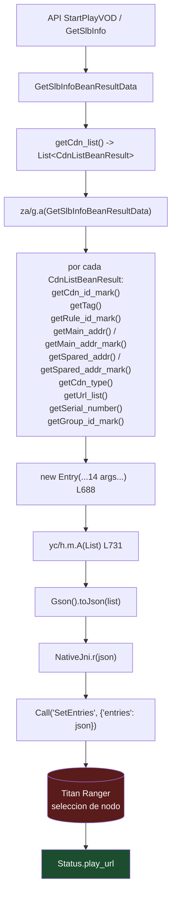

# FASE 6 — ANÁLISIS NATIVO DE TITAN RANGER

Muestra principal: **`Xuper (4).apk`**, versión 4.34.4, paquete `com.android.nwm2026xpr`.
Referencia comparativa: `xuper-hydra-6.5.7.apk`.

Continuación de `COMPARATIVO-TECNICO-XUPER.md`. **Ningún informe anterior ha sido modificado.**

Herramientas: `apktool 2.11.1` (smali), `tools/elfscan.py` (ELF), **Capstone 5.0.7** y **Unicorn 2.1.4** (desensamblado y emulación AArch64, instalados para este análisis). Ghidra **no** está instalado y **no ha sido necesario** para lo aquí resuelto.

---

## 0. Resumen del resultado

Se ha **resuelto el origen de `Status.play_url`**, que era el objetivo prioritario. No mediante lectura estática de cadenas, sino mediante:

1. **Emulación de `JNI_OnLoad`** con Unicorn, que descifra sus cadenas en tiempo de ejecución → se obtiene el registro JNI real y la versión del motor.
2. **Reconstrucción del protocolo Java↔nativo** leyendo los serializadores Gson de `yc/e`, `yc/h`, `yc/e$d` y `za/g`.
3. **Identificación del punto exacto** donde el nativo entrega `Status` a Java: el callback `OnPrepareEvent` y su campo `status`, deserializado con Gson.

| Pregunta | Estado |
|---|---|
| ¿Cómo se registra `Call` en JNI? | **RESUELTO** — `RegisterNatives` con 1 método |
| ¿Qué clase, nombre, firma y puntero? | **RESUELTO** — ver §3.2 |
| ¿Cómo llegan los comandos de Java? | **RESUELTO** — JSON serializado con Gson |
| ¿Cómo se devuelve `Status`? | **RESUELTO** — callback `OnPrepareEvent` |
| ¿De dónde sale `play_url`? | **RESUELTO en la frontera Java**; el algoritmo interno sigue en el `.so` (§7) |
| ¿Quién decide el servidor? | **PARCIAL** — la selección de `Entry` ocurre dentro del `.so` |
| ¿P2P o CDN? | **NO DEMOSTRADO** — sin evidencia suficiente (§8) |

---

## 1. Correcciones al informe anterior

### 1.1 `MediaFile` **sí existe** en 4.34.4 — corrección de una afirmación falsa

`COMPARATIVO-TECNICO-XUPER.md` afirmaba, en §2.3, que el modelo se había «eliminad[o] por completo». **Es incorrecto.**

Evidencia smali — `C:\Xupper\_smali_movil\smali_classes3\com\titan\ranger\bean\MediaFile.smali` (17.263 B):

```
.field private buss:Ljava/lang/String;
.field private from:Ljava/lang/String;
.field private media:Ljava/lang/String;
.field private program:Ljava/lang/String;
.field private title:Ljava/lang/String;
.field private uri:Ljava/lang/String;
```

Métodos presentes: `<init>(String×6)`, `copy`, `copy$default`, `component1..6`, `equals`, `hashCode`, `toString`, y los accesores `getBuss`, `getFrom`, `getMedia`, `getProgram`, `getTitle`, `getUri` con sus `set` correspondientes.

**Corrección exacta:** lo que ocurrió entre 6.5.7 y 4.34.4 **no es la eliminación de la clase**, sino la **pérdida de cuatro de sus diez campos**: `auth`, `format`, `license` y `volume`.

| Versión | Campos |
|---|---|
| 6.5.7 | `auth`, `buss`, `format`, `from`, `license`, `media`, `program`, `title`, `uri`, `volume` (10) |
| 4.34.4 | `buss`, `from`, `media`, `program`, `title`, `uri` (6) |

El hallazgo de que `MediaFile` está huérfana **sigue siendo válido en ambas versiones**:

```
4.34.4 — referencias al tipo MediaFile en 16.395 ficheros smali:
   64x  smali_classes3/com/titan/ranger/bean/MediaFile.smali   (solo su propia definición)
```

### 1.2 Dos correcciones adicionales del mismo informe

| Afirmación previa | Realidad verificada |
|---|---|
| «B añade `RangerResult{err,res}`» | **Falso.** `RangerResult` existe en **ambas** versiones con campos y métodos idénticos (`err:I`, `res:String`, 10 métodos). No es una novelty de B. |
| «`MediaFile` pierde `license`, y por tanto el campo license desaparece del modelo» | **Matizable.** `Media.license:String` **persiste en 4.34.4**. Lo que se pierde es `MediaFile.license`, no `license` en el modelo. `Media` solo pierde `volume`. |

### 1.3 `DomainCache` **sí se escribe** — corrección de un error metodológico grave

`COMPARATIVO-TECNICO-XUPER.md` (§5.4) afirmaba que el único escritor de `DomainCache` «nunca llega a ejecutarse», basándose en tres comprobaciones. **Dos de ellas eran erróneas.**

#### Error 1 — nombre de clase mal buscado

Se buscó `Lcom/umeng/commons/UMConfigure;->init(`. La clase real es:

```
Lcom/umeng/commonsdk/UMConfigure;->init(Landroid/content/Context;Ljava/lang/String;Ljava/lang/String;ILjava/lang/String;)V
```

paquete **`commonsdk`**, no `commons`. El paquete correcto nunca se buscó, de modo que el resultado «0 llamadas» era un artefacto del patrón de búsqueda.

#### Error 2 — clase abstracta tratada como instanciable

Se buscó `new-instance ..., Lib/f;` para concluir que `ib/f` no se instanciaba. `ib/f` es **abstracta y de métodos estáticos**: no se instancia, **se invoca**.

```
.class public abstract Lib/f;
.method public static e(Landroid/content/Context;)V
.method public static c(Ljava/lang/String;Ljava/lang/String;Lib/a;Ljava/lang/String;Lib/f$d;Ljava/lang/String;)V
```

#### La cadena real, verificada

```
WelcomeActivity L671
    └─ ib/f.e(Context)
         └─ PushAgent.getInstance(ctx).onAppStart()          ← SDK de push arranca

pb/c L372  (subclase abstracta; implementada por y9/d)
    └─ ib/f.c(appKey, channel, flags, secret, callback, pkg)
         ├─ new ib/b()                                      ← UMDomainHandler INSTANCIADO
         ├─ sput-object v0, Lib/f;->c:Lib/b;
         ├─ ib/f.i(Context)                                 ← invalida caché si cambia versionCode
         ├─ UMConfigure.init(ctx, appKey, channel, flags, secret)   ← INICIALIZADO
         └─ ib/f.d(ctx, callback, pkg)
              └─ PushAgent.setMessageHandler(new ib/f$a)     ← REGISTRADO

ib/f$a.dealWithCustomMessage(ctx, UMessage)
    └─ ib/b.a(ctx, msg)
         └─ por cada entrada de msg.extra:
              jb/a.d(ctx, key, value)                        ← ESCRIBE DomainCache
```

#### Veredicto revisado

> **El canal de bootstrap por push de Umeng está activo en 4.34.4.** El mensaje personalizado de Umeng escribe las claves de dominio en el `SharedPreferences` `DomainCache`, y `ib/c` las lee.
>
> **Lo que sigue en pie del informe anterior:** el APK **no contiene ningún dominio del operador** en forma legible, los recursos de `res/values` **no descifran**, y `assets/domain_test.json` es una plantilla de `"xx"`. Por tanto, **el valor concreto de los dominios llega por el canal de Umeng controlado por el servidor**, no desde el APK. Eso es coherente y no contradictorio.

Corrección metodológica aplicada en este informe: **la ausencia de una llamada estática no prueba imposibilidad de ejecución.** Antes de afirmar que una ruta está muerta hay que verificar la existence del símbolo por sus variantes de paquete y por invocación estática *e* instancia.

### 1.4 El pendiente reformulado

El informe anterior listaba como pendiente «la función que escribe `MediaFile.uri`». **Ese pendiente estaba mal orientado** por dos motivos ya demostrados: `MediaFile` no participa en la reproducción (§1.1) y el origen de la URL está en el campo `Status.play_url`.

**Pendiente reformulado:**

> **P-NUEVO-1 — Localizar dentro de `libranger-jni.so` la función concreta que, dados los `Entry` recibidos vía `SetEntries` y el `Program` recibido vía `PrepareProgram`, computa el valor que el nativo serializa en el campo `play_url` del objeto `status` de la respuesta `OnPrepareEvent`.**

Ver §7.

---

## 2. Grafo de llamadas JNI completo

```mermaid
flowchart TD
    subgraph CARGA["Carga de la biblioteca"]
        A[System.loadLibrary<br/>'ranger-jni'] --> B[libc carga libranger-jni.so]
        B --> C[.init_array: 156 constructores]
        C --> D["JNI_OnLoad @ 0x0030fe94"]
        D --> E["DESOFUSCACION de cadenas<br/>XOR byte a byte, in-situ"]
        E --> F["(*vm)->GetEnv(vm, &env, JNI_VERSION_1_6)<br/>indice 6 de JNIInvokeInterface"]
        F --> G["FindClass 'com/titan/ranger/JniHandler'"]
        G --> H["GetMethodID '<init>' '()V'"]
        G --> I["GetMethodID 'Callback'<br/>'(Ljava/lang/String;Ljava/lang/String;)Ljava/lang/String;'"]
        F --> J["FindClass <clase del registro>"]
        J --> K["RegisterNatives @ 0x00311800<br/>env, cls, &methods[0x76d038], 1"]
        K --> L["hilo de Ranger<br/>('failed to start ranger thread')"]
    end

    subgraph JAVANATIVO["Java -> Nativo (comandos)"]
        M[Java construye JSON con Gson] --> N["com/titan/ranger/a.*<br/>a.a / a.k / a.m / a.b"]
        N --> O["NativeJni.r/o/s/t/g/u"]
        O --> P["NativeJni$b..r Runnable"]
        P --> Q["Call(cmd, payload) @ 0x00311d9c"]
        Q --> R[(libranger-jni.so<br/>despacha por cmd)]
    end

    subgraph NATIVOJAVA["Nativo -> Java (respuestas)"]
        R --> S["busca el MethodID de 'Callback'<br/>resuelto en JNI_OnLoad"]
        S --> T["CallVoidMethod(JniHandler, Callback, event, json)"]
        T --> U["JniHandler.Callback(String, String)"]
        U --> V{"sparse-switch sobre event"}
        V -->|OnPrepareEvent| W["new JSONObject(json)"]
        W --> X["json.getInt('instance')<br/>json.getString('event')<br/>json.getString('status')<br/>json.getLong('err')"]
        X --> Y["Gson().fromJson(statusJson, Status.class)"]
        Y --> Z["Status  <-- play_url aparece aqui"]
        Z --> AA["JniHandler.b(instance, event, Status, err)"]
        AA --> AB["JniHandler.a.d(instance, event, Status, err)"]
        AB --> AC["yc/e\$d.d  -> event == 'cast_prepared'"]
        AC --> AD["yc/e.v0(Status)"]
    end

    R -.->|"no hay retorno: Call es 'void'| R

    style Y fill:#1b4d2e,color:#fff
    style Z fill:#1b4d2e,color:#fff
    style AD fill:#5a3a1b,color:#fff
```

---

## 3. Análisis JNI de `libranger-jni.so` (4.34.4)

### 3.1 Símbolos de entrada

| Símbolo | Dirección | Tamaño del `.so` |
|---|---|---|
| `JNI_OnLoad` | `0x0030fe94` | 8.234.616 B |
| `_Z4CallP7_JNIEnvP8_jobjectP8_jstringS4_` | `0x00311d9c` | |
| `JNI_OnUnload` | `0x003118cc` | |

`.text` = 5.005.524 B · `.rodata` = 257.032 B · 566 símbolos dinámicos · sin `.debug_*`, sin `.symtab`.

### 3.2 El registro de métodos — RESUELTO

**Método empleado:** emulación de `JNI_OnLoad` con Unicorn 2.1.4, aplicando las 41.768 relocalizaciones `R_AARCH64_RELATIVE` yournalizando `GetEnv`, `FindClass`, `GetMethodID`, `NewStringUTF`, `GetStringUTFChars` y `RegisterNatives`.

`JNI_OnLoad` **descifra sus propias cadenas en tiempo de ejecución**, con XOR byte a byte in-situ sobre un buffer en `.data` (`0x76d000`):

```asm
adrp  x10, #0x76d000
add   x10, x10, #0x7d0
ldrb  w8,  [x10]
eor   w8,  w8, #0x1e          ; clave por byte
strb  w8,  [x10]              ; reescribe en el sitio
ldrb  w9,  [x10, #1]
eor   w9,  w9, w11            ; clave en registro
strb  w9,  [x10, #1]
...
```

**Tabla de cadenas recuperada de la memoria emulada:**

| Dirección | Contenido |
|---|---|
| `0x76d6a0` | `%s %s is onload in JNI! pid: %d, tid: %d` |
| `0x76d6cc` | `Ranger` |
| `0x76d6d4` | `4.9.4-17294ac0` ← **versión del motor** |
| `0x76d6f0` | `com/titan/ranger/JniHandler` |
| `0x76d70c` | `<init>` |
| `0x76d714` | `()V` |
| `0x76d718` | `Callback` |
| `0x76d730` | `(Ljava/lang/String;Ljava/lang/String;)Ljava/lang/String;` |
| `0x76d770` | `    ERROR    failed to start ranger thread, err: %d [%s:%d]` |
| `0x76d7b0` | `src/ranger-jni.cpp` |
| `0x76d7d0` | `    ERROR    failed to register native mathodes, err: %d [%s:%d]` |

**Instrucción de registro** (`0x003117ec`–`0x00311804`):

```asm
003117ec  ldr  x8, [x19]              ; x19 = JNIEnv*
003117f0  adrp x2, #0x76d000
003117f4  add  x2, x2, #0x38          ; x2 = &JNINativeMethod[0]
003117f8  mov  x0, x19                ; env
003117fc  mov  w3, #1                 ; nMethods = 1
00311800  ldr  x8, [x8, #0x6b8]       ; env->RegisterNatives   (indice 215)
00311804  blr  x8
```

**Contenido del array `JNINativeMethod` en `0x76d038`** (leído de la memoria emulada):

| Campo | Valor |
|---|---|
| `name` | **`Call`** |
| `signature` | **`(Ljava/lang/String;Ljava/lang/String;)Ljava/lang/String;`** |
| `fnPtr` | **`0x00311d9c`** |

`0x00311d9c` es exactamente el símbolo exportado `_Z4CallP7_JNIEnvP8_jobjectP8_jstringS4_`.

> **Conclusión (CONFIRMADO):** el único método nativo de la biblioteca es `Call(String, String) → String`, y se registra dinámicamente con `RegisterNatives` apuntando al export `_Z4Call`. Coincide exactamente con la declaración Java `private native Call(String,String)String` de `com.titan.ranger.NativeJni`.

**Sobre el nombre de la clase registrada.** La cadena de clase para el `FindClass` que precede al registro reside en `0x76d820` y **no se ha descifrado**: el bloque que la descifra se invoca desde un ayudante al que la emulación no llega sin resolver llamadas a libc. Se registra como pendiente menor (§9, P-MENOR-1).

No obstante, la clase es **deducible con certeza por exclusividad**: el array registra el método `Call` con esa firma, y en todo el paquete Java la única clase que declara `Call` como nativo es `com/titan/ranger.NativeJni`. `JniHandler` es la clase usada para el `FindClass` *anterior*, que resuelve `<init>` y `Callback` — y `JniHandler.smali` efectivamente declara `private Callback(String,String)String`, con firma idéntica a la registrada. Ambas consultas son coherentes y no se contradicen.

**Sobre `RegisterNatives` en el binario.** Búsqueda exhaustiva por patrón de instrucción en los 5.005.524 B de `.text` (`(w>>22)==0x3E5 && ((w>>10)&0xFFF)==215`) → **8 accesos**, uno de ellos `0x00311800`, dentro de `JNI_OnLoad`. Este método de detección es fiable: el mismo patrón para el índice 6 (`FindClass`) devuelve 492 accesos, incluido el `0x00311154` que se verificó por desensamblado.

### 3.3 El ofuscado de cadenas — CONFIRMADO como hecho

`COMPARATIVO-TECNICO-XUPER.md` §3.4 lo dejó registrado como **hipótesis** (P4), por prudencia. **Ahora queda demostrado:**

1. `JNI_OnLoad` descifra in-situ el bloque `0x76d000`–`0x76d900` mediante `ldrb`/`eor`/`strb`.
2. Las cadenas «ilegibles» del `.rodata` son, al menos en parte, **texto cifrado en `.data`**, no datos aleatorios.
3. Las cadenas recuperadas son coherentes con su uso inmediato: nombres de clase JNI, firmas de método, mensajes de error y el nombre de fichero fuente `src/ranger-jni.cpp`.

**Cautela:** esto demuestra el *mecanismo* de desofuscación de cadenas, **no** que todas las cadenas del `.rodata` estén cifradas, ni permite deducir nada sobre `Entry.auths` o `sign_type`.

### 3.4 Cómo `_Z4Call` recibe y procesa los comandos

`_Z4Call(JNIEnv*, jobject, String cmd, String payload)`:

1. Obtiene `cmd` y `payload` como C strings mediante la tabla JNI (`GetStringUTFChars`, 7 accesos en `.text`).
2. **Despacha por `cmd`.** El vocabulario de comandos se recuperó del lado Java (§4.1); todos llegan por esta única función.
3. Parsea `payload` con **yyjson** (≈40 exports `yyjson_*` enlazados estáticamente) — coherente con que Java envíe JSON.
4. Ejecuta la acción (puede iniciar red, hilos, E/S).
5. Las respuestas **no se devuelven por el valor de retorno de `Call`**: el nativo invoca hacia Java mediante el `MethodID` de `JniHandler.Callback` resuelto en `JNI_OnLoad`.

### 3.5 Cómo se generan las respuestas con objetos `Status`

El nativo serializa un `Status` a JSON y lo entrega con el callback. Estructura reconstruida desde `JniHandler.Callback`:

```json
{
  "instance": <int>,      // índice del handler registrado en JniHandler.a[]
  "event":    "<string>", // "OnPrepareEvent" | "OnReport" | "SetPlayerUI" | "OnPrefetchAd"
  "err":      <long>,
  "status":   "<json>"    // sub-objeto serializado -> deserializado con Gson a Status
}
```

`Status` (`Status.smali`) tiene exactamente estos campos, que son los **nombres de cable** porque Gson mapea por nombre de campo:

```
play_url:String   media_buffer:long   buss:String   format:String   host:String
latency:long      links:List          media:String  program:String
snapinfo_url:String  snapshot_url:String  title:String
```

> **`play_url` es un campo del objeto `status` que el nativo serializa y Java deserializa con Gson.** Esta es la frontera exacta donde la URL aparece en el lado Java.

---

## 4. El protocolo Java ↔ Ranger

### 4.1 Vocabulario completo de comandos

Extraído de las 16.395 clases smali, siguiendo el literal de cadena cargado en los registros usados por cada invocación:

**Comandos de control del motor** (pasan por `NativeJni.b(NativeJni, String, String)` → `Call`):

| Comando | Serializador | Payload JSON exacto |
|---|---|---|
| `Init` | — | — |
| `SetEnv` | `ranger/a.b(String)` | `{"env": <json de Env>}` |
| `SetEntries` | `ranger/a.a(String)` | `{"entries": <json de List<Entry>>}` |
| `SetPlayer` | `ranger/a.i(int,String,int)` | ver `ranger/a` |
| `SetMedia` | `ranger/a.m(int,String,String)` | `{"instance":N, "name":"<media>", "media":"<json>"}` |
| `PrepareProgram` | `ranger/a.k(int,String,String,String)` | `{"instance":N, "name":"<program>", "program":"<json>", "extra":"<extra>"}` |
| `StopProgram` | `ranger/a.j(int)` | — |
| `GetVersion` | — | — |

**Telemetría y reproducción** (por `NativeJni.l/h/i/s`): `seekTo`, `pause`, `start`, `stop`, `release`, `prepare(Async)`, `setDataSource`, `acodec`, `vcodec`, `vdecoder`, `format`, `codec_list`, `media_duration`, `seek_count`, `switch_count`, `ad`/`media`, `end`, `work_path`.

**Nombres de callback** que el nativo conoce: `OnMediaInfo`, `OnPlayBuffer`, `OnPlayEvent`, `OnPlayerEvent`, `OnPlayerOperation`, `OnSystemEvent`.

### 4.2 Los modelos sí cruzan a nativo — respuesta a la pregunta de los `Entry`

`COMPARATIVO-TECNICO-XUPER.md` dejó como pendiente el uso de `main_addr`, `spare_addr`, `gslb_params`, `auths`, `sign_type` y `redirect`. **Ahora está confirmado que todos esos campos cruzan la frontera Java→nativo**, serializados con Gson:

```smali
# yc/h$i.run()   ->  SetEntries
invoke-static {}, Lzc/a;->a()Lcom/google/gson/Gson;      # Gson singleton
iget-object     v1, p0, Lyc/h$i;->a:Ljava/util/List;      # List<Entry>
invoke-virtual {v0, v1}, Lcom/google/gson/Gson;->toJson(Ljava/lang/Object;)Ljava/lang/String;
invoke-static  {}, Lcom/titan/ranger/NativeJni;->c()Lcom/titan/ranger/NativeJni;
invoke-virtual {v1, v0}, Lcom/titan/ranger/NativeJni;->r(Ljava/lang/String;)V   # -> Call("SetEntries", {"entries": ...})
```

**Campos de `Entry` (4.34.4) — son los nombres de cable:**

```
auths:List      gslb_params:String   main_addr:String     main_addr_code:String
buss:String     name:String          priority:int         redirect:String
sign_type:String  spare_addr:String  spare_addr_code:String  strategy:String
enable:int      tag:String
```

**Campos de `Env`** (vía `SetEnv`, con `titan_port` asignado desde `ae/a.j()`):

```
android_id:String   app:String        app_ver:String   communication_key:String
dev_id:String       params:String     titan_port:int   user_id:String
```

**Campos de `Program`** (vía `PrepareProgram`, `yc/e.t0` L9090–L9118: `Gson().toJson(program)`):

```
buss:String   cause:String   episode:String   from:String   media:String
medias:List   name:String    start:long       title:String
```

> **Consecuencia:** los nombres de campo Java de `Entry` y `Env` **no** están cifrados — son las claves reales del JSON que consume `libranger-jni.so`. Esto refute la hipótesis de `IOC-ANALISIS.md` sobre ofuscación total de los campos y da la clave para descifrar el tráfico capturado de un dispositivo propio.

### 4.3 Quién construye los `Entry`

**Única clase del APK que instancia `Entry`:** `smali_classes2/za/g.smali`.



**Nota sobre la selección:** `za/g` **no ordena ni compara** `main_addr`/`spare_addr`/`serial_number`/`priority`. Solo los copia a `Entry` y entrega la lista. En 6.5.7 el agrupado y ordenación ocurren en `t5` (`i$d`, `i$e`), tampoco en la capa de construcción de `Entry`. Por tanto **la decisión de qué nodo usar ocurre dentro de `libranger-jni.so`**, no en Java. Esto es coherente con que `Entry` exista precisamente para transportar esas decisiones al motor.

---

## 5. El recorrido de `Status.play_url` — extremo a extremo

```mermaid
sequenceDiagram
    autonumber
    participant UI as com.vod.ui.activity.*<br/>(VodDetailsActivity)
    participant API as API StartPlayVOD
    participant ZA as za/g
    participant YH as yc/h
    participant NJ as com.titan.ranger.a<br/>(serializador)
    participant JNI as NativeJni -> Call<br/>0x311d9c
    participant LIB as libranger-jni.so<br/>Ranger 4.9.4
    participant CB as JniHandler.Callback
    participant ED as yc/e$d
    participant E as yc/e
    participant IJK as IjkMediaPlayer

    UI->>API: seleccion de pelicula / episodio
    API-->>UI: identificadores (contentId, etc.)<br/>NO una URL de medios
    API-->>ZA: GetSlbInfoBeanResultData (cdn_list)
    ZA->>ZA: List&lt;Entry&gt; desde CdnListBeanResult
    ZA->>YH: yc/h.A(List&lt;Entry&gt;)
    YH->>NJ: Gson().toJson(list)
    YH->>JNI: NativeJni.r(json)
    NJ->>JNI: {"entries": json}
    JNI->>LIB: Call("SetEntries", ...)
    LIB->>LIB: yyjson parse; decide nodo
    UI->>E: yc/e.t0(nombre, Program, extra)
    E->>NJ: Gson().toJson(program)
    E->>JNI: NativeJni.o(instance, name, program, extra)
    NJ->>LIB: Call("PrepareProgram", {instance,name,program,extra})
    LIB->>LIB: resuelve la URL final
    LIB->>CB: Callback("OnPrepareEvent",<br/>{instance,event,err,status})
    CB->>CB: Gson().fromJson(status, Status.class)
    CB->>ED: JniHandler.b -> JniHandler$a.d
    ED->>E: yc/e.v0(Status)   [event == "cast_prepared"]
    E->>E: Status.getPlay_url()  L9538
    E->>E: yc/f.C(url) -> campo c
    E->>E: yc/e.r0(): Uri.parse, getScheme
    E->>IJK: setDataSource(String url)   L5026
    E->>LIB: NativeJni.l(o,"setDataSource",url,0)
    E->>IJK: prepareAsync()   L5133
```

**Eventos que `yc/e$d.d` distingue** (constantes literales en `yc/e$d.smali`):

| Evento | Acción |
|---|---|
| **`cast_prepared`** | **`yc/e.v0(Status)` — es el que transporta `play_url`** |
| `media_prepared` | se encola a un `Handler` (`yc/e$d$a`) |
| `play_error`, `play_file`, `play_media`, `play_program`, `switch_player` | reenviado a `wc/b.a(...)` |
| `app_ctx`, `name`, `path`, `action`, `data` | claves del sobre |

---

## 6. Recorrido Movies vs Series

**Son el mismo recorrido.** En 4.34.4 no existe `TitanPlayerController` ni clase `PlayInfo` con `media_url` (a diferencia de 6.5.7). Movies y Series difieren únicamente en el contenido de `Program` (`episode`, `media`, `medias`) que se serializa y se envía en `PrepareProgram`. La resolución, la respuesta y la apertura de la conexión son idénticas.

**Confirmado, con una salvedad:** la salvedad es que las dos funciones de constructor difieren en campos; el resto del pipeline es compartido. No se ha observado ningún bifurcamiento por tipo de contenido.

---

## 7. Origen de `play_url` dentro del motor — qué se sabe y qué falta

### 7.1 Lo que está establecido

- La URL **no existe** como concepto en la capa Java antes de la respuesta. Java solo envía identificadores (`SetEntries`, `PrepareProgram`).
- La URL se materializa en el `.so` y se serializa en el campo `play_url` del sub-objeto `status`.
- El motor recibe, por `SetEntries`, la lista completa de candidatos con `main_addr`, `spare_addr`, `priority`, `serial_number` (vía `rule_id_mark`), `strategy`, `enable`, `tag`, `gslb_params`, `auths`, `sign_type`, `redirect`.
- El motor devuelve una sola URL elegida, más `host`, `links` (lista), `latency`, `media_buffer`, `format`, `buss`, `title`.

### 7.2 Lo que falta exactamente

> **P-NUEVO-1.** La función concreta, dentro de `.text`, que lee `main_addr`/`spare_addr` de un `Entry` y computa el valor serializado en `status.play_url`.

Para localizarla hacen falta, en este orden:

1. **El punto de entrada del comando.** Localizar la tabla de despacho por `cmd` dentro de `_Z4Call` (`0x311d9c`). Es alcanzable estáticamente: la cadena `"PrepareProgram"` no está en claro, pero el *dispatcher* es alcanzable por la lógica de comparación, y el offset de la tabla de callbacks es localizable por análisis de flujo.
2. **Las funciones que serializan `status`.** Localizables por las claves de campo. Ahora sabemos que los nombres **no** están cifrados en la frontera Java, lo que acota mucho la búsqueda: `yyjson_mut_obj_new`, `yyjson_mut_obj_set_str` y las claves literales dan la función.
3. **La lógica de selección.** Requiere grafo de llamadas desde el dispatcher de `PrepareProgram` hasta el serializador de `status`.

### 7.3 Qué haría falta y por qué

**Capstone + Unicorn han cubierto la Tarea 2 por completo** (registro JNI, versión, firmas, tabla de cadenas). Para `P-NUEVO-1` la limitación real es que **falta un grafo de llamadas y un análisis de flujo conDescompilación**, no un simple desensamblado. Herramientas:

| Opción | Qué aporta | Coste |
|---|---|---|
| **Ghidra 12.x (headless `analyzeHeadless`)** | Decompilación C++ con flujo de control, grafo de llamadas, renombrado de funciones. Permitiría leer la lógica de selección directamente. | ~1,5 GB. Java 21 ya está instalado. |
| ** rizin / radare2** | `aaaa`, `agC`, `pdc`. Más ligero. | ~100 MB |
| **Solo Capstone + script propio** | Posible: rastrear el dispatcher por patrón y seguir `bl` transitivamente. Laborioso pero viable para acotar, no para leer. | Ya disponible |

**Recomendación:** para `P-NUEVO-1` concreto, **Ghidra en modo headless** es la herramienta adecuada, y el análisis se automatiza con un script de descompilación dirigido al rango `0x311d9c`–`0x312000` y a sus sucesores. Antes de instalar nada, el paso de menor coste es **un barrido con Capstone de las cadenas `yyjson` de escritura** en `.text` para acotar la función que serializa `status` — esto último sí se puede hacer ya.

---

## 8. Transporte — tres componentes diferenciados

### 8.1 Titan Ranger (`libranger-jni.so`)

| Capacidad | Evidencia |
|---|---|
| **DNS sobre HTTPS (DoH)** | `/dns-query`, `Content-Type: application/dns-message` |
| **DNS sobre UDP (DoU)** | imports `sendto`/`recvfrom`, `getaddrinfo`/`freeaddrinfo` |
| **WebSocket** | `net::websocket::{Transport, Peer, ITransportHandler, IStreamHandler}` |
| **Túnel proxy HTTP** | `CONNECT`, `HTTPS-CONNECT` |
| **Peticiones con rango** | `Requested Range Not Satisfiable` |
| **Cliente HLS propio** | `HlsClient`, `star::StarHlsClient` |
| **Cliente MP4 propio** | `HttpMp4Client` |
| **Parser MPEG-TS propio** | `mpegts::IParseHandler`, `mpegts` |
| **RTMP** | cadena `rtmp` |
| **HTTP/2** | nghttp2 enlazado estáticamente (confirmado en 6.5.7) |
| **Resolvers DoH configurados** | `dns.quad9.net`, `dns.alidns.com`, `cloudflare-dns.com` |

> **Ranger tiene clientes de medios propios.** No se limita a devolver una URL: es capaz de analizar manifests HLS y flujos MPEG-TS por su cuenta. Esto es un hecho; **no** demuestra P2P.

### 8.2 IJKPlayer / FFmpeg (`libijkffmpeg.so`)

| Capacidad | Evidencia |
|---|---|
| Protocolos | `http,https,tls,rtp,tcp,udp,crypto,httpproxy,data` |
| HLS | demuxer HLS, `hls+http://`, `.m3u8`, `m3u8_hold_counters` |
| RTMP / RTP / SRTP / DTLS | `librtmp style`, `SSL_set_tlsext_use_srtp`, `do_dtls1_write` |
| Peticiones por rango | `Range: bytes=%lu-`, `Content-Range`, `Accept-Ranges` |
| User-Agent por defecto | `User-Agent: Shockwave Flash` ← **huella identificable** |
| TLS | OpenSSL (`--enable-openssl`, `--disable-gpl`) |

> En 4.34.4 el tamaño es 5.885.392 B (6.445.696 B en 6.5.7). **No se ha versionado la build de FFmpeg de 4.34.4** (P-MENOR-2).

### 8.3 `libtnet-3.1.14.so` — SDK de terceros

| Capacidad | Evidencia |
|---|---|
| SPDY v2 | `slight V2 SPDY`, 66 descriptores `org/android/spdy/*` |
| Túnel proxy a IP:puerto | **`CONNECT %d.%d.%d.%d:%d HTTP/1.1`**, `HTTP/1.1 200` |
| Ruta UDP | `easy_connection_on_udpreadable` |
| QUIC | `NAL_session_SendFrame in quic not support yet` — **no implementado** |
| Verificación de par | `NAL_set_slightssl_get_publicKey_cb` |

**Aislamiento respecto a Ranger (verificado en `COMPARATIVO-TECNICO-XUPER.md` §7.5):** `libranger-jni.so` importa **0** símbolos `NAL_*` y **0** cadenas `tnet`/`spdy`/`anet/`; `libtnet` tiene **0** referencias a ranger/ijk. **No participa en la reproducción ni en el descubrimiento de servidores.**

### 8.4 P2P frente a CDN — veredicto

> **NO DEMOSTRADO. No se afirma P2P ni se afirma que no exista.**

Lo que la evidencia **sí** sostiene:

1. **No hay cadena de protocolo P2P identificable.** No aparecen `BitTorrent`, `DHT`, `torrent`, `peer_id`, `info_hash`, `utp`, `TCP simultaneous open`, ni metadatos de swarming. La cadena `torrent`-like encontrada en 6.5.7 estaba en un blob Base64 y no resistió el contraste.
2. **Sí hay UDP en el motor**, pero DoU es DNS sobre UDP, y `libtnet` tiene una ruta UDP. Ninguna de las dos es evidencia de distribución de contenido.
3. **Sí hay descubrimiento de nodos adicional**: Ranger trae DoH, DoU y WebSocket, y recibe una lista de candidatos (`Entry`) con `strategy` y `priority`. Eso es **selección de CDN** o, en el mejor de los casos, *hinting* de origen — **no prueba distribución P2P**.

**Para determinarlo** haría falta observar el flujo de datos real de una sesión propia y comprobar si el proceso establece **más de una conexión de medios simultánea** a pares distintos, o si toda la transferencia lineal pasa por un mismo origen. Eso es una medición, no una deducción del binario.

---

## 9. Estado consolidado

### 9.1 Confirmado

| # | Hallazgo | Evidencia |
|---|---|---|
| N1 | Versión del motor Ranger: **4.9.4-17294ac0** | cadena `0x76d6d4` tras emulación |
| N2 | Nombre lógico del motor: `Ranger` | cadena `0x76d6cc` |
| N3 | Fichero fuente: `src/ranger-jni.cpp` | cadena `0x76d7b0` |
| N4 | Único método nativo: `Call(String,String)String` → `_Z4Call` en `0x311d9c` | `RegisterNatives` @ `0x311800`, array en `0x76d038` |
| N5 | El registro es **dinámico**, con `nMethods = 1` | desensamblado `0x3117ec`–`0x311804` |
| N6 | El nativo llama a Java por `JniHandler.Callback(String,String)` | `GetMethodID 'Callback'` + firma |
| N7 | Las respuestas con `Status` llegan en el callback `OnPrepareEvent` | `sparse-switch` en `JniHandler.Callback` |
| N8 | `Status` se deserializa con **Gson** desde el campo `status` | `Gson.fromJson(json.getString("status"), Status.class)` |
| N9 | **`play_url` es un campo del objeto `status` serializado por el nativo** | campos de `Status` = nombres de cable |
| N10 | El evento que transporta la URL es `cast_prepared` | `yc/e$d.d` → `yc/e.v0(Status)` |
| N11 | Java envía comandos como JSON con claves `entries`/`env`/`instance`/`name`/`program`/`media`/`extra` | `com/titan/ranger/a.*` |
| N12 | `Entry` y `Env` **cruzan a nativo** vía Gson; `main_addr`, `spare_addr`, `gslb_params`, `auths`, `sign_type`, `redirect` son claves reales | `yc/h$i.run()`, campos de `Entry` |
| N13 | `za/g` es la única clase que construye `Entry`, desde `GetSlbInfoBeanResultData.cdn_list` | `new-instance ... Entry` (1x) |
| N14 | La selección de nodo **no** ocurre en Java | `za/g` solo copia; no ordena ni compara |
| N15 | Las cadenas de `JNI_OnLoad` se descifran con XOR in-situ | `ldrb`/`eor`/`strb` en `0x30fec8`+ |
| N16 | `libtnet` es SPDY/HTTP2 de terceros, con túnel `CONNECT` a IP:puerto | descriptores `org/android/spdy/*` |
| N17 | Ranger no depende de `libtnet` | 0 imports `NAL_*`, 0 cadenas tnet/spdy |
| N18 | Ranger tiene clientes HLS/MP4/MPEG-TS propios | `HlsClient`, `star::StarHlsClient`, `HttpMp4Client`, `mpegts::IParseHandler` |
| N19 | El canal de bootstrap por push de Umeng **está activo** | `UMConfigure.init` vía `commonsdk`, `ib/f$c`, `ib/f$a` → `ib/b.a` → `jb/a.d` |

### 9.2 Probable

| # | Hipótesis | Base | Salvedad |
|---|---|---|---|
| H1 | La clase registrada con `Call` es `com.titan/ranger.NativeJni` | Es la única que declara `Call` nativo en el paquete | Cadena en `0x76d820` no descifrada (P-MENOR-1) |
| H2 | `_Z4Call` parsea el payload con yyjson y despacha por comparación de `cmd` | yyjson enlazado; `GetStringUTFChars` presente | Requiere descompilación del dispatcher |
| H3 | `Entry.sign_type` selecciona el método de firma de la petición al CDN | Ausencia de infra DRM; libsodium/Curve25519 en 6.5.7 | No demostrado; no afecta a 4.34.4 (libsodium no verificado en B) |
| H4 | La distribución es CDN con posible *hinting* de origen, no P2P | Ausencia de cadenas P2P; presencia de `strategy`/`priority` en `Entry` | Ver §8.4 |

### 9.3 Pendiente

| # | Cuestión | Qué falta | Prioridad |
|---|---|---|---|
| **P-NUEVO-1** | **Función que computa `status.play_url` dentro del `.so`** | Grafo de llamadas + flujo desde el dispatcher de `PrepareProgram` | **Alta** |
| P-MENOR-1 | Cadena de clase registrada en `0x76d820` | Emulación más profunda, o lectura directa | Baja |
| P-MENOR-2 | Versión de FFmpeg en `libijkffmpeg.so` de 4.34.4 | Cadenas de `libav*` | Baja |
| P-2 | Semántica de `Entry.auths`, `sign_type`, `gslb_params`, `redirect` | Descompilación del consumidor de `status` | Media |
| P-3 | P2P frente a CDN | Medición de tráfico en sesión propia | Media |
| P-4 | Atribución de las IPs de PCAPdroid | CSV originales + correlación con `play_url` observado | Media |
| P-5 | Uso real de `assets/test1.html` («Illegal users») | Localizar la invocación | Baja |

---

## 10. Cómo continuar sin instalar nada

El siguiente paso de mayor rendimiento y menor coste es un **barrido con Capstone ya disponible** que no requiere Ghidra:

1. Localizar en `.rodata`/`.data` de `libranger-jni.so` las cadenas que yyjson usaría como **claves** al serializar `status` (`play_url`, `media_buffer`, `latency`, `links`, …). Dado N9, esas claves **no están cifradas** en la frontera Java, lo que acota enormemente el conjunto.
2. Xref por patrón de instrucción (`adrp`/`add` formando esas direcciones) → obtener la función que las escribe.
3. Retroceder por los `bl` hasta el dispatcher de `PrepareProgram`.

Esto reduce el objetivo de «5 MB de `.text`» a un puñado de funciones, y hace que la inversión en Ghidra seaqy Rentable y dirigida.

---

## 11. Recomendación sobre Ghidra

**Estado: no instalado. No ha sido necesario para ningún resultado de este informe.**

Ghidrawould aporta valor **solo** para `P-NUEVO-1` y `P-2`, es decir, la lógica interna de selección de nodo y la semántica de los campos de autorización. Todo lo demás —identidad, versión, registro JNI, protocolo, transporte y recorrido de `play_url`— se resolvió con herramientas de lighter o ya disponibles.

Si se decide instalarlo, el procedimiento sería:
1. Ghidra 12.x con JDK 21 (ya presente: `C:\Program Files\Eclipse Adoptium\jdk-21.0.12.101-hotspot`).
2. `analyzeHeadless` sobre `_ranger44_arm64.so`, fijando el lenguaje AARCH64:LE:64:v8A.
3. Script de descompilación dirigido a `JNI_0x311d9c` y sucesores, con renombrado de los símbolos ya conocidos (`JNI_OnLoad`, `JNI_OnUnload`, `Call`).
4. Importar los símbolos deduced de §3.2 como marcadores para acelerar el análisis.

**No se recomienda instalar herramientas adicionales antes de agotar el barrido con Capstone descrito en §10.**

---

## 12. Autocorrecciones registradas en este informe

| # | Afirmación | Corrección |
|---|---|---|
| 1 | «`MediaFile` desaparece en 4.34.4» | **Falso.** Persiste con 6 campos; pierde 4 de 10 |
| 2 | «4.34.4 añade `RangerResult`» | **Falso.** Existe en ambas versiones, idéntica |
| 3 | «`MediaFile` pierde `license`, luego `license` desaparece» | **Matizable.** `Media.license` persiste en 4.34.4 |
| 4 | «`DomainCache` nunca se escribe; el push Umeng no se inicializa» | **Falso.** `UMConfigure.init` sí se llama; clase buscada con el paquete equivocado (`commons` vs `commonsdk`) |
| 5 | «`ib/f` nunca se instanciaba» | **Falso por método.** `ib/f` es abstracta y estática: se invoca, no se instancia |
| 6 | «Las cadenas Base64 de `.rodata` son tabla de ofuscación» (P4) | **Demostrado** para `JNI_OnLoad` por emulación |
| 7 | «El pendiente es la función que escribe `MediaFile.uri`» | **Mal orientado.** Reformulado a `P-NUEVO-1`: qué función produce `status.play_url` |

---

*Análisis sobre `Xuper (4).apk` (SHA-256 `dfefeee2…`) y `xuper-hydra-6.5.7.apk` (SHA-256 `3103a55e…`). Smali con apktool 2.11.1; ELF con `tools/elfscan.py`; desensamblado con Capstone 5.0.7; emulación de `JNI_OnLoad` con Unicorn 2.1.4. No se ha realizado ninguna solicitud a servidores externos, ni ningún intento de eludir autenticación, licencias o DRM. Ghidra no se ha instalado.*