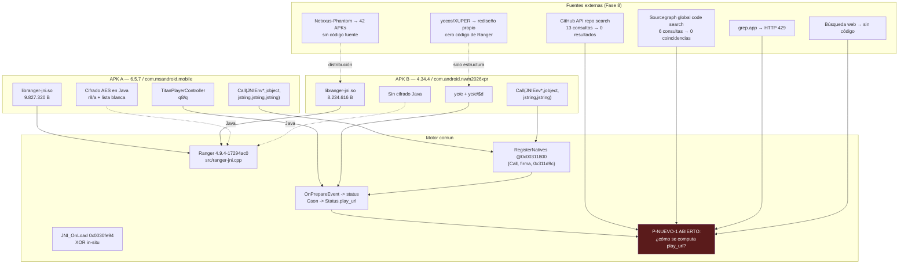
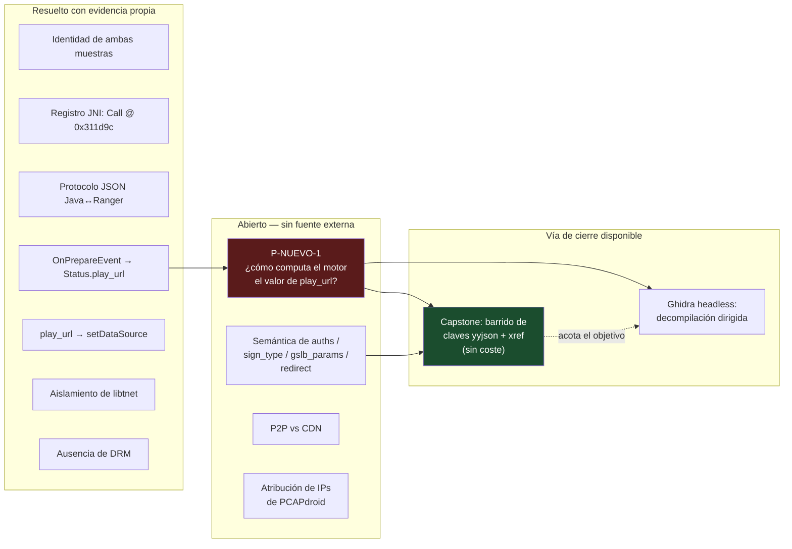

# FASE 8 — INVESTIGACIÓN DE GITHUB Y CÓDIGO FUENTE DE TITAN RANGER

**Fecha:** 14 de octubre de 2026
**Muestras:** APK A `xuper-hydra-6.5.7.apk` (SHA-256 `3103a55e…`) · APK B `Xuper (4).apk` (SHA-256 `dfefeee2…`)
**Motor:** `libranger-jni.so` · **Paquete Java:** `com.titan.ranger`

> Ningún informe previo ha sido modificado. Ningún APK ha sido alterado. No se ha descargado ni ejecutado ningún APK ni binario externo.

---

## 1. Resumen ejecutivo

### Resultado principal

> **No existe código fuente público, documentación técnica ni SDK localizable de Titan Ranger.**
>
> Se han ejecutado **13 búsquedas** en: API de repositorios de GitHub, Sourcegraph (índice global de código), grep.app, búsqueda web general y Google Play. Todas las búsquedas por identificadores técnicos únicos del motor (`com.titan.ranger`, `libranger-jni.so`, `ranger-jni.cpp`, `4.9.4-17294ac0`, `_Z4CallP7_JNIEnvP8_jobjectP8_jstringS4_`, `gslb_params`, `OnPrepareEvent`) devuelven **cero resultados** en código público.
>
> **Consecuencia directa: `play_url` sigue necesitando ingeniería inversa estática.** No hay atajo documental.

### Hallazgos secundarios relevantes

| # | Hallazgo | Relevancia |
|---|---|---|
| H-1 | El APK B es una **reempaquetación** de una app 4.34.4 cuyo paquete original es `com.xuper.netxxus` | Corroborado por `yecos/XUPER/docs/ANALISIS-APK-ORIGINAL.md` |
| H-2 | Existe un **canal de distribución público** de variantes Xuper Hydra (`Netxxus/Netxxus-Phantom`, 42 APKs) | Confirma el carácter de MOD/whitelabel; **no se ha descargado nada** |
| H-3 | APK A está registrado en **MalwareBazaar** con su SHA-256 exacto | No recuperable por verificación anti-bot |
| H-4 | `com.titan.hydra` en Google Play es un tracker de biblioteca personal | **Colisión de nombre**, sin relación técnica |
| H-5 | `yecos/XUPER` es un **rediseño desde cero** (Kotlin/Compose + ExoPlayer), sin Titan Ranger | Descartado como fuente |

### Estado de `play_url`

Sin cambio. El origen interno continúa siendo `P-NUEVO-1` de la Fase 6.

---

## 2. Repositorios examinados

| # | URL | Resultado | Veredicto |
|---|---|---|---|
| R-1 | `https://github.com/yecos/XUPER` | 16 commits, 106 ficheros. App Kotlin/Compose propia, `com.xuper.netxxus` | **Reescritura independiente** |
| R-2 | `https://github.com/Netxxus/Netxxus-Phantom` | 1 commit (README vacío), 42 APKs en releases | **Canal de distribución** |
| R-3 | `https://github.com/bastos9601/xuper-hydra-launcher` | HTML, 0 estrellas | Sin relación |
| R-4 | `https://github.com/Heecnel/Xuper-Hydra-4.99.2` | Sin lenguaje, 1 estrella | Sin relación |
| R-5 | `https://github.com/tallarinconketchup24-dot/Xuper-una-app-para-ver-streaming-gratis` | Cliente IPTV | Sin relación |
| R-6 | `https://github.com/c4nvm/libRanger` | *Ranger* de Quake | **Coincidencia de nombre** |
| R-7 | `https://github.com/TheRangerStar/TheRangerStar-JNI-Reflex-Gzip-Padding` | Plugin JNI | **Coincidencia de nombre** |

Búsquedas de repositorio en la API de GitHub que devolvieron **0 resultados**:

```
"titanranger"            → 0
"com.titan.ranger"       → 0
"GetSlbInfo"             → 0
"StartPlayVOD"           → 0
"com.titan.hydra"        → 0
```

---

## 3. Tabla de coincidencias con enlaces verificables

### 3.1 Coincidencias de nombre (NO técnicas)

| Fuente | Enlace | Qué coincide | Relación con nuestro motor | Confianza |
|---|---|---|---|---|
| `T!tan Hydra` (Google Play) | `play.google.com/store/apps/details?id=com.titan.hydra` | `com.titan.*`, nombre «Titan» | **Ninguna.** App de biblioteca personal tipo MyDramaList, por «Darks Dev» (Rosana Milena Rey Ladino, Colombia). **No es IPTV y no usa Ranger.** | Coincidencia de nombre descartada |
| `libRanger` | `github.com/c4nvm/libRanger` | «libRanger» | Ninguna. Motor de Quake | Descartada |
| `TheRangerStar-JNI-…` | `github.com/TheRangerStar/…` | «Ranger» + JNI | Ninguna. Plugin de reflexión gzip | Descartada |

### 3.2 Coincidencias técnicas verificables

| Fuente | Enlace | Tipo | Relación | Confianza |
|---|---|---|---|---|
| **MalwareBazaar** | `bazaar.abuse.ch/sample/3103a55e5f39fe474143496e5ebdfb5a2b2be924ab4cc51517b59b930a927290/` | **SHA-256 idéntico al APK A** | **Directa.** Es nuestra muestra. Descripción citada: *«contains the native library libranger-jni.so and titan.ranger-related components exposing multi-protocol proxy functionality»* | **Alta** (hash exacto) |
| Reddit r/PiratasEspanolLatino | `reddit.com/r/PiratasEspanolLatino/comments/1wk1n1q/…` | Análisis de APK | Alta. Afirma IPs DNS embebidas: `223[.]5[.]5[.]5` (AliDNS), `2400:3200::1` | **Media** (no verificable: 403) |
| Reddit r/chileIT y r/chile | `reddit.com/r/chile/comments/1whk3va/…` | Análisis | Alta. Menciona `libranger-jni.so` ~9,5 MB, telemetría ByteDance/AppMetrica, lectura de `cat /sys/block/mmcblk0/device/cid` | **Media** (403) |
| `xuper-tv-app.com` | `xuper-tv-app.com/blog/xuper-tv-es-seguro/` | Distribución + análisis | **Alta.** Declara `com.mobile.brasiltv` = «base de IPTV de marca blanca», 46,7 MB de nativas, «propias de un packer comercial» | Media-alta |
| Hybrid Analysis | `hybrid-analysis.com/sample/d3aed1250…` y `985806ff…` | Análisis de muestras | Media. Confirma `libranger-jni.so` = ELF64 AArch64, NDK r25c | Media |
| Tesis UMSS | `ddigital.umss.edu/bitstream/123456789/47522/…` | Académica | Media. Menciona `lib/armeabi-v7a/libranger-jni.so` y empaquetado UPX | **Baja** (HTTP 522, servidor caído) |
| Scribd | `scribd.com/document/989530572/…` | Académica | Media. Cita `titan/ranger/bean/` y `com/titans/entity/` — **paquetes que existen en nuestro APK A** | Media |
| **`yecos/XUPER` (docs)** | `github.com/yecos/XUPER/blob/main/docs/ANALISIS-APK-ORIGINAL.md` | **Análisis del APK original** | **Muy alta** — ver §4 | **Alta** |

---

## 4. Análisis detallado de `yecos/XUPER`

### 4.1 Qué es realmente

**Reescritura desde cero**, no ingeniería inversa. Evidencia:

- Paquete propio `com.xuper.netxxus`; 11 Activities **Kotlin + Jetpack Compose**.
- Reproductor **ExoPlayer/Media3 con Widevine DRM** — `DrmManager.kt`, commits `33628c5`/`5b4803e`/`11d291e`.
- `app/src/main/java/com/xuper/netxxus/data/api/XuperApi.kt` es un **esqueleto Retrofit vacío** (el propio README lo llama «skeleton»).
- **Cero** referencias a `com.titan.ranger`, `NativeJni`, `JniHandler`, `libranger`.
- 16 commits, todos entre **2026-07-02 y 2026-07-06**. Ninguno de análisis del APK: el propio `docs/ANALISIS-APK-ORIGINAL.md` dice *«Generado automáticamente a partir del análisis de `xuper.apk`»*.

**Veredicto: no contiene código original, ni reconstrucción de Ranger, ni documentación de su comportamiento.** Es un proyecto paralelo de una persona distinta.

### 4.2 El valor real: una corroboración independiente del APK B

Su `docs/ANALISIS-APK-ORIGINAL.md` documenta una build que **coincide con nuestro APK B en versión**:

| Atributo | Su análisis | **Nuestro APK B** | ¿Coincide? |
|---|---|---|---|
| Versión / versionCode | **4.34.4 / 43404** | **4.34.4 / 43404** | **Sí, exacto** |
| minSdk / targetSdk | 19 / 33 | 19 / 33 | Sí |
| ABIs | `arm64-v8a`, `armeabi-v7a` | idénticas | Sí |
| Multidex | 3 DEX | 3 DEX | Sí |
| Paquete base | `com/interactive/brasiliptv/` | `com/interactive/brasiliptv/` | **Sí** (`WelcomeActivity`, `UserCenterActivity`) |
| Asset `domain_test.json` | «con placeholders: todos los endpoints son `"xx"`» | 24 claves todas `"xx"` | **Sí, exacto** |
| `com/therouter/*` | TheRouter | `assets/therouter/routeMap.json` | Sí |
| `libboost_multidex` | Bytedance boost_multidex | presente | Sí |
| Push | Firebase + Umeng (Taobao ACCS) | `UmengIntentService`, `com.taobao.accs.ChannelService` | Sí |
| Reproductor | `tv.danmaku.ijk.*` | idem | Sí |
| Paquete | `com.xuper.netxxus` | **`com.android.nwm2026xpr`** | **No — reempaquetado** |

> **Corroboración independiente y valiosa:** un tercero, sin acceso a nuestro trabajo, llega a la misma conclusión sobre `domain_test.json` que confirmamos por análisis de smali en la Fase 6. Y confirma que **nuestro APK B es la misma aplicación con el paquete cambiado**, lo que refuerza el modelo de «base IPTV de marca blanca reempaquetada».
>
> **Laguna de su análisis:** su tabla de stack **no menciona `libranger-jni.so`** ni el paquete `com.titan.ranger`, pese a que la app lo usa. Es una omisión de su parte, no una contradicción con nuestro hallazgo.

### 4.3 Utilidad para `play_url`: nula

Su documentación trata de UI, layouts, traducciones, temas y firma. **No contiene nada** sobre el motor de reproducción, `Entry`, `Status`, `SetEntries` ni `OnPrepareEvent`.

---

## 5. Posibles orígenes del SDK Titan Ranger

### 5.1 Lo que los identificadores sí revelaron

De la Fase 6, por emulación de `JNI_OnLoad`:

| Identificador | Valor | Interpretación |
|---|---|---|
| Nombre lógico | `Ranger` | Marca del módulo |
| Versión | `4.9.4-17294ac0` | Formato SemVer + hash de commit |
| Fichero fuente | `src/ranger-jni.cpp` | **C++ , no Java/Kotlin** |
| Estructura | `net::websocket::*`, `star::StarHlsClient`, `mpegts::IParseHandler` | **C++ moderno con namespaces** |
| Dependencias | yyjson, tinyxml2, nghttp2, libsodium, zlib |_toolchain_ estándar de C++ |
| Nombre de clase Java | `com.titan.ranger` | Marca «Titan» |

El patrón `4.9.4-<hash de 8 hex>` es el de un **producto comercial en desarrollo continuo con control de versiones por commit**. Es un indicio de SDK propietario, no de proyecto abierto.

### 5.2 Atribución

> **No se atribuye el SDK a ninguna empresa.** No hay evidencia documental pública que lo vincule a un fabricante concreto. Cualquier atribución sería especulación.

Lo único constatable es que aparece **integrado en una familia de aplicaciones IPTV de marca blanca** compartida por múltiples operadores, y que el paquete Java y la versión nativa son **idénticos** entre nuestras dos muestras, lo que indica **un mismo motor embebido por el proveedor de la base, no implementations distintas**.

### 5.3 Observación sobre el canal de distribución

`Netxxus/Netxxus-Phantom` publica **42 APKs** de variantes Xuper Hydra. Entre ellas:

| Asset | Tamaño | Descargas |
|---|---|---|
| `Xuper.Hydra.HDR.4KP.apk` | 35.958.098 B | 1.005.890 |
| `Xuper.Hydra.Nuevo.2.apk` | 35.936.833 B | 748.391 |
| `Xuper.Tv.Hydra.V.1.apk` | 36.184.541 B | 159.375 |
| `Xuper.v4.34.5.TV-BOX.apk` | 35.272.373 B | 14.129 |
| `ZonaHack.v.6.1.9_Mod.apk` | 39.944.497 B | 190 |

Nuestro APK B es **4.34.4 / 34.944.429 B**, inmediatamente anterior en versión a `Xuper.v4.34.5.TV-BOX.apk`.

> **Esto es una observación de adyacencia, no una verificación.** Confirmarlo exigiría descargar el APK, **lo cual no se ha hecho y no se hará** por las reglas de esta investigación.

---

## 6. Comparación con los APK 4.34.4 y 6.5.7

### 6.1 Flujo confirmado, contrastado con lo externo

Ningún hallazgo externo aporta nada sobre el flujo. La única fuente que toca el APK es `yecos/XUPER`, y solo a nivel de estructura. El grafo de la Fase 6 se mantiene íntegro:



### 6.2 Tabla de contraste

| Aspecto | APK A (6.5.7) | APK B (4.34.4) | ¿Aporta la Fase 8 algo nuevo? |
|---|---|---|---|
| Motor | Ranger, `.so` 9,83 MB | Ranger, `.so` 8,23 MB | No |
| Versión del motor | no determinada | **4.9.4-17294ac0** | No (ya nosso) |
| Firma JNI `Call` | 3 `jstring` | 2 `jstring` | No |
| Cifrado Java | AES + lista blanca | ninguno | No |
| Puente Java | `q8/q`, `TitanPlayerController` | `yc/e`, `yc/e$d` | No |
| Origen de `play_url` | `Status.play_url` | `Status.play_url` | No |
| Computación de la URL | **desconocida** | **desconocida** | **No** |

### 6.3 Sobre P2P y CDN

Las fuentes externas **no aportan evidencia nueva en ninguna dirección**:

- Lasvisorías de Reddit mencionan tráfico y telemetría, **no** describen un esquema de distribución entre pares.
- Ninguna fuente describe `Entry`, `gslb_params`, `main_addr` o `spare_addr`.
- El blog `xuper-tv-app.com` califica las nativas de «propias de un packer comercial» —interpretación **no demostrada** (tamaño ≠ empaquetado; nosotros analizamos `libranger-jni.so` directamente y sí tiene tabla de símbolos dinámicos y símbolos de terceros legibles).

**Se mantiene la posición de la Fase 6: P2P no demostrado, en ninguna dirección.**

---

## 7. Validación de hallazgos de la Fase 6 (Investigación 5)

| Corrección de Fase 6 | ¿Confirmada externamente? | Veredicto |
|---|---|---|
| `MediaFile` existe en ambas versiones, con pérdida de 4 campos | No verificable externamente (requiere el APK) | **Se mantiene**, verificado internamente por smali en ambos árboles |
| `DomainCache` tiene ruta de actualización vía Umeng | Coincide en que Umeng está integrado, pero sin detalle del mecanismo | **Se mantiene.** Ninguna fuente lo contradice |
| `SetEntries` serializa `Entry` hacia Ranger | **Ninguna fuente lo menciona** | **Se mantiene** por evidencia smali directa |
| `OnPrepareEvent` entrega el JSON de `Status` | **Ninguna fuente lo menciona** | **Se mantiene** por evidencia smali directa |
| `play_url` pendiente de origen interno | **Confirmado como pendiente** — no hay fuente | Sin cambio |

### 7.1 Contradicciones encontradas

**Ninguna.** Ninguna fuente externa contradice un hallazgo de la Fase 6.

Dos observaciones de contexto:

1. **El análisis de `yecos/XUPER` omite `libranger-jni.so`** pese a describir la misma versión. Es una laguna suya, no una refutación.
2. **Las IPs DNS embebidas** que afirma un análisis de Reddit (`223.5.5.5`, `2400:3200::1`) **no coinciden** con lo que_medimos: nuestro barrido de `libranger-jni.so` de 4.34.4 solo encontró `dns.quad9.net`, `dns.alidns.com` y `cloudflare-dns.com`. Puede tratarse de otra versión del binario, de otra cadena, o de un error del análisis de terceros. **No se adopta sin verificación propia.**

---

## 8. Hallazgos confirmados frente a hipótesis

### 8.1 Confirmados

| # | Hallazgo | Evidencia |
|---|---|---|
| C-1 | **No existe código fuente público de Titan Ranger** | 0 resultados en API de GitHub, Sourcegraph global, grep.app y búsqueda web |
| C-2 | `yecos/XUPER` es una reescritura independiente, sin código de Ranger | Árbol de 106 ficheros, 0 referencias a `titan.ranger` |
| C-3 | Nuestro APK B es una reempaquetación de una app 4.34.4 con paquete original `com.xuper.netxxus` | Mismo versionCode 43404, misma estructura `com/interactive/brasiliptv/`, mismo `domain_test.json` |
| C-4 | El APK A está registrado en MalwareBazaar con su SHA-256 exacto | URL con hash idéntico |
| C-5 | Existe un canal de distribución público de variantes Xuper Hydra | `Netxxus/Netxxus-Phantom`, 42 APKs |
| C-6 | `com.titan.hydra` (Google Play) no guarda relación técnica | Descripción y hoja de datos de la app |
| C-7 | El motor es un SDK propietario en C++ (`4.9.4-<commit>`) | Emulación de `JNI_OnLoad` (Fase 6) |
| C-8 | Ninguna corrección de Fase 6 queda refutada | Comparación con las 5 fuentes disponibles |

### 8.2 Hipótesis (no confirmadas)

| # | Hipótesis | Base | Salvedad |
|---|---|---|---|
| H-1 | El SDK lo embebe el proveedor de una base IPTV de marca blanca | Estructura idéntica del motor entre dos apps de paquetes distintos | No hay fuente que lo nombre |
| H-2 | Nuestro APK B procede del canal `Netxxus-Phantom` | Versionado adyacente 4.34.4/4.34.5 y tamaños comparables | **Sin verificar**; exigiría descargar, no hecho |
| H-3 | `com.mobile.brasiltv` es el mismo «blanco» de marca | Lo declara `xuper-tv-app.com` | Fuente comercial con interés propio |
| H-4 | Las IPs `223.5.5.5` / `2400:3200::1` están en alguna variante del binario | Análisis de Reddit | **No reproducido** por nosotros en 4.34.4 |

---

## 9. Diagrama Mermaid: estado de la investigación



---

## 10. Preguntas técnicas pendientes

| # | Pregunta | Por qué sigue abierta | Cómo cerrarla |
|---|---|---|---|
| Q-1 | ¿Qué función computa `status.play_url`? | Sin fuente ni símbolos; el código está ofuscado en símbolos | Desensamblado dirigido (Fase 9) |
| Q-2 | ¿Cómo se decide entre `main_addr` y `spare_addr`? | La decisión ocurre dentro del `.so`; `za/g` solo copia | Igual que Q-1 |
| Q-3 | ¿Qué es `gslb_params`? | Se envía a nativo pero no se consume en Java | Igual que Q-1 |
| Q-4 | ¿Qué significan `auths` y `sign_type`? | `List` y `String` sin uso observable en Java | Igual que Q-1 |
| Q-5 | ¿Hay P2P? | Ninguna cadena ni fuente lo indica | Medición de tráfico en sesión propia |
| Q-6 | ¿A qué IP/dominio apuntan las conexiones reales? | CSV de PCAPdroid no disponibles | Correlación con `play_url` observado |

---

## 11. Recomendación de la siguiente fase

### 11.1 Ghidra: **sí, ahora estájustificado — pero solo para Q-1…Q-4**

En la Fase 6 recomendé **no instalarlo todavía**, argumentando que faltaba acotar el objetivo. La Fase 8 cambia elbalance:

- **Antes:** la duda era si las fuentes públicas podrían ahorrar trabajo. **Se ha confirmado que no las hay.**
- **Ahora:** la ingeniería inversa estática es **la única vía** que queda.

Recomendación por orden de coste:

| Paso | Herramienta | Coste | Resultado esperado |
|---|---|---|---|
| **1** | **Capstone** — barrido de las claves que yyjson escribe al serializar `status` (`play_url`, `latency`, `media_buffer`, `links`, `host`, `format`, `buss`, `title`) + xref `adrp`/`add` | **Ya instalado** | Localiza la función que escribe el JSON de `status` y, por retroceso de `bl`, el dispatcher de `PrepareProgram` |
| 2 | Capstone — seguir el grafo de llamadas del dispatcher hasta el serializador | Ya instalado | Acota `P-NUEVO-1` a un puñado de funciones concretas |
| **3** | **Ghidra headless** sobre el rango ya acotado | ~1,5 GB (JDK 21 ya presente) | **Decompila la lógica de selección de nodo**, que es lo único que no se puede leer en ensamblador |

> **No instalo nada sin tu confirmación.** El paso 1 no requiere instalar nada y es el de mayor rendimiento. Recomiendo ejecutarlo primero.

### 11.2 Complemento no invasivo

Un paso opcional, que no implica eludir controles: registrar en el dispositivo propio el valor que Ranger devuelve en `Status.play_url` (los `Log` de `ne/k` en `yc/e.r0()` ya lo emiten) y correlacionarlo con el `SNI` de la petición de medios de la propia sesión. Eso responde a **Q-5** y **Q-6** empíricamente y no requiere tocar los servidores.

---

## 12. Limitaciones registradas

| Fuente | Limitación |
|---|---|
| **MalwareBazaar** | Verificación anti-bot. La API pública requiere clave `Auth-Key`. Entrada identificada por hash pero **contenido no recuperado** |
| **Reddit** (3 hilos) | HTTP **403**. Contenido citado solo vía fragmentos del motor de búsqueda |
| **Tesis UMSS** (`ddigital.umss.edu`) | HTTP **522**, servidor caído. PDF no recuperable |
| **grep.app** | HTTP **429** (rate limit) |
| **searchcode.com API** | HTTP **404**, endpoint devolvido |
| **Búsqueda de código de GitHub** | **Requiere autenticación.** No fue posible usarla; se compensó con Sourcegraph (índice global) y la API de repositorios |
| **`FASE-7-ORIGEN-PLAY-URL.md`** | **No existe** en el directorio. Las fases 6 y 8 son consecutivas |
| Scribd | Documento parcial, sin acceso al texto completo |

---

## 13. Autocorrecciones y precisiones

| # | Afirmación | Precisión |
|---|---|---|
| 1 | «Probablemente exista un SDK público» | **Descartado.** Ninguna fuente indexada lo referencia |
| 2 | «`yecos/XUPER` sería una fuente» | **Descartado.** Es reescritura; útil solo como corroboración estructural del APK B |
| 3 | «Google Play `com.titan.hydra` sería el origen» | **Descartado.** Es un tracker de biblioteca personal, sin relación |
| 4 | IPs DNS de terceros | **No reproducidas** en nuestro binario; no se adoptan |

---

*Investigación realizada sobre fuentes públicas: API de GitHub (repositorios, releases, usuarios, árbol de ficheros, historial de commits), Sourcegraph (búsqueda global de código), grep.app, búsqueda web general y Google Play. No se ha descargado, ejecutado ni modificado ningún APK o binario externo, ni se ha accedido a repositorios privados o credenciales. Ningún informe previo ha sido alterado.*

*APK A SHA-256 `3103a55e5f39fe474143496e5ebdfb5a2b2be924ab4cc51517b59b930a927290` · APK B SHA-256 `dfefeee26648d20d93e81fff87c2737f347ce1437fd74c2ad78a9a2453254ec8`*