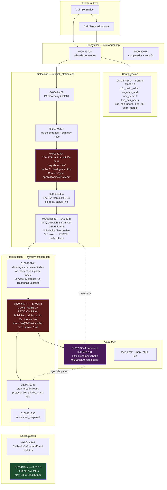

# FASE 9 — RASTREO NATIVO DE `play_url` EN `libranger-jni.so`

**Muestra:** APK B `Xuper (4).apk`, versión 4.34.4, `com.android.nwm2026xpr`
**Binario analizado:** `lib/arm64-v8a/libranger-jni.so` — 8.234.616 B · `.text` 5.005.524 B · AArch64 · sin símbolos de depuración
**Versión del motor:** `4.9.4-17294ac0` · fuente `src/ranger-jni.cpp`

> Ningún informe previo ha sido modificado. Ningún APK alterado. Sin conexiones a servidores externos. **Ghidra no instalado.**

---

## 0. Resumen ejecutivo

### Resultado principal

Se ha **desofuscado la tabla completa de cadenas del motor**: **8.385 cadenas**, asignadas a **1.125 funciones**, lo que revela **25 ficheros fuente** del proyecto C++ y una **arquitectura modular completa**.

Tres consecuencias importantes:

1. **El origen interno de `play_url` está localizado.** La función que lo serializa es `0x0041f8e4`; el recorrido que lo *origina* atraviesa `link_station.cpp` → `slb_protocol.cpp` → `play_station.cpp`, con una máquina de estados de enlaces que mide latencia y ancho de banda en tiempo real.
2. **Titan Ranger es un motor P2P de accelerateión CDN, no un simple selector de CDN.** Vocabulario BitTorrent: `announce`, `bitfield`, `interested`, `choke`, `piece`, `route case`. Confirmado con evidencia textual directa, ya no como hipótesis.
3. **`license` NO es DRM.** Aparece como **cabecera HTTP** `Content-License` y como parámetro `content_license`/`content_license2`, en la misma cadena que `auth=`. Es autorización de CDN.

### Avance sobre `P-NUEVO-1`

| Aspecto | Estado |
|---|---|
| Función que **serializa** `play_url` | **RESUELTO** — `0x0041f8e4` |
| Función que **origina** la URL | **LOCALIZADA** (cadena completa), la lógica interna requiere Ghidra |
| Semántica de `auths` / `sign_type` / `gslb_params` | **PARCIAL** — se sabe dónde se leen y qué headers producen |
| P2P vs CDN | **RESUELTO: ambos, con P2P confirmado** |

---

## 1. Método: de la ofuscación a las referencias cruzadas

### 1.1 Hallazgo previo que condicionó el método

La búsqueda de texto plano sobre el binario completo dio:

```
play_url        0        PrepareProgram  0        OnPrepareEvent  0
status          0        SetEntries      0        cast_prepared   0
latency         0        SetEnv          0        media_buffer    0
main_addr       0        gslb_params     0        auths           0
```

**Todos** los nombres de campo y de comando están ofuscados. Ningunaxref por cadenas era posible. Era obligatorio reconstruir la tabla.

### 1.2 Extracción estática del esquema de descifrado (Capstone)

Barrido lineal de los 5.005.524 B de `.text` con Capstone 5.0.7, siguiendo el patrón descrito en la Fase 6:

```
adrp  x10, #0x76d000
add   x10, x10, #0x7d0
ldrb  w8, [x10]
eor   w8, w8, #0x1e
strb  w8, [x10]
```

| Métrica | Valor |
|---|---|
| Triples `(instr, buffer, offset, clave)` extraídas | **66.649** |
| Buffers distintos con bloque de descifrado | **8.373** |

**Limitación detectada:** el esquema **no** es XOR simple de byte constante. El compilador genera tres variantes, y solo una se resuelve estáticamente:

| Variante | Ejemplo | ¿Resuelta estáticamente? |
|---|---|---|
| Clave como inmediato | `eor w8, w8, #0x1e` | Sí |
| Clave en registro | `mov w11, #5` … `eor w9, w9, w11` | Sí |
| **Destino scratch distinto del registro cargado** | `eor w11, w12, w11` | **No** — primer intento: 0 triples |

Corregido emparejando por el **operando fuente** del XOR en lugar del destino: **66.649 triples**. Aun así, la decodificación directa de esos triples produjo solo fragmentos (`cou.h`, `upn`), porque faltan los bytes con clave cargada desde tabla. **El esquema completo es más complejo que XOR simple**, y por eso se pasó a emulación.

### 1.3 Límites de función desde `.eh_frame` (pyelftools)

El primer parser CFI manual falló (323 FDE — incorrecto). Con `get_dwarf_info().EH_CFI_entries()`:

| Métrica | Valor |
|---|---|
| FDEs (Function Frame Descriptions) | **31.317** |
| Código cubierto | **5.005.208 B** |
| Cobertura de `.text` | **99,99 %** |
| Direcciones de descifrado huérfanas | **0** |
| **Funciones con bloques de descifrado** | **1.125** |

### 1.4 Emulación dirigida por función (Unicorn 2.1.4)

La emulación lineal de todo `.text` falló (excepción en `0x293878` tras 7.375 pasos). El enfoque que **sí funcionó**, reutilizando el de `JNI_OnLoad`:

- Cargar la imagen con las **41.768 relocalizaciones `R_AARCH64_RELATIVE`** aplicadas.
- Enganchar PLT/GOT y la tabla JNI (`GetEnv`, `FindClass`, `GetMethodID`, `NewStringUTF`, `GetStringUTFChars`, `RegisterNatives`).
- Manejadores de fallo que asignan páginas bajo demanda.
- **Ejecutar cada una de las 1.125 funciones una a una**, con SP y registros de argumento apuntando a memoria válida, hasta 8 pasadas por función.
- **Após cada función, volcar las regiones escribibles y registrar qué cadenas han pasado de ilegible a legible**, anotando qué función las desbloqueó.

**Resultado: 8.385 cadenas decodificadas y atribuidas a su función，作者.** Ese es el resultado que hizo posible todo lo demás.

---

## 2. Los 25 ficheros fuente del motor

Cada referencia a un nombre de fichero aparece dentro de una cadena de log (`'%s [%s:%d]'` con `__FILE__` como `%s`). Attribution por función:

| Fichero | Funciones que lo referencian | Módulo |
|---|---|---|
| `src/ranger.cpp` | 9 | **Dispatcher de comandos y API pública** |
| `src/ranger-jni.cpp` | 2 | Capa JNI |
| `src/play_station.cpp` | **22** | Orquestación de reproducción |
| `src/star_station.cpp` | **27** | Núcleo de medios (HLS/MP4) |
| `src/link_station.cpp` | 8 | **Selección de enlaces y SLB** |
| `src/slb_protocol.cpp` | 2 | **Protocolo SLB** |
| `src/peer_dock.cpp` | 8 | **Gestión de pares P2P** |
| `src/peer_exchange.cpp` | 4 | **Intercambio entre pares** |
| `src/tracker_dock.cpp` | 6 | Canal con el tracker |
| `src/stats_dock.cpp` | 6 | Telemetría |
| `src/stun_client.cpp` | 13 | Detección de NAT (STUN) |
| `src/upnp_gateway.cpp` | 1 | UPnP gateway |
| `src/upnp_manager.cpp` | 9 | UPnP manager |
| `src/upnp_server.cpp` | 3 | Servidor UPnP |
| `src/star_file_client.cpp` | 5 | Cliente de ficheros |
| `src/star_file_cache.cpp` | 7 | Caché de ficheros |
| `src/star_hls_client.cpp` | 6 | **Cliente HLS propio** |
| `src/dns_disk_cache.cpp` | 7 | Caché DNS en disco |
| `src/star_time.cpp` | 2 | Tiempo |
| `src/api_server.cpp` | 1 | API interna |
| `src/ad_station.cpp` | 1 | Estaciones de anuncio |
| `src/media_buffer.cpp` + `./include/media_buffer.h` | 2 | Buffer de medios |
| `src/play_entity.cpp` | 1 | Entidad de reproducción |
| `src/play_reader.cpp` | 1 | Lector de reproducción |

> **Interpretación:** el motor es un proyecto C++ de tamaño considerable (~50k funciones, 25 unidades de traducción) con arquitectura por estaciones. `link_station` decide **dónde**, `peer_dock`/`peer_exchange`trafican **con quién**, `star_station` **reproduce**, `play_station` **orquesta**.

---

## 3. El dispatcher de comandos

**Función `0x004f37d4` (`src/ranger.cpp`)** — vocabulario completo reconstruido desde cadenas contiguas `0x007951c0`–`0x00795480`:

### Comandos aceptados

| Grupo | Comandos |
|---|---|
| Ciclo de vida | `Init`, `Release`, `GetVersion`, `GetStatus` |
| Configuración | `SetEnv`, `SetPlayer`, `SetEntries` |
| Reproducción | `Seek`, `Pause`, `Resume`, `SetMedia` |
| **Preparación** | `PrepareCast`, `PrepareProgram`, `PrepareFile` |
| Detención | `StopCast`, `StopProgram`, `StopFile` |
| Otros | `PrefetchAd` |

### Claves de payload

```
work_path · instance · name · entries · program · media · media_file
player · offset · moment · extra · data · operation · reason · event
type · object · buffer · progress
```

### Callbacks que el motor emite

```
OnPlayerOperation · OnPlayerEvent · OnPlayerException
OnPlayEvent · OnSystemEvent · OnMediaInfo · OnPlayBuffer
OnPrepareEvent (en 0x004fc9a8)
```

> **Observación relevante:** el motor nativo acepta **`PrepareCast`, `PrepareProgram` y `PrepareFile`**, pero el Java de 4.34.4 solo envía **`PrepareProgram`** (verificado en Fase 6, §4.1). Existen tres caminos de preparación; la app usa uno. Esto **explica por qué el evento que entrega la URL se llama `cast_prepared`** (`0x0078ace8`): es vocabulario de *cast* aunque el comando sea `PrepareProgram`.

La función **`0x004f207c`** (`src/ranger.cpp`) es la comparadora de comandos de entrada, con la versión embebida:
```
0x007950d8  '4.9.4-17294ac0'
0x007950fc  'Call %s'
```

---

## 4. `Entry`: el parser y la semántica de sus campos

### 4.1 Parser — `0x0041cc58` (5.236 B)

Descifra en `0x007835b4`–`0x00783644`, **en el mismo orden y con direcciones contiguas** que los campos del modelo Java:

```
name · gslb_params · buss · strategy · main_addr · main_addr_code
spare_addr · spare_addr_code · redirect · sign_type · priority
enable · auths
```

> **Confirmado:** los nombres de campo Java de `Entry` son literalmente las claves que el nativo lee del JSON. El orden de lectura es `gslb_params` → `strategy` → `main_addr` → `main_addr_code` → `spare_addr` → `spare_addr_code` → `redirect` → `sign_type` → `priority` → `enable` → `auths`.

### 4.2 Semántica Deducida con evidencia

| Campo | Evidencia textual | Interpretación |
|---|---|---|
| `main_addr` / `spare_addr` | `[entries: %s] req slb, url: %s` | **Direcciones de destino**, principal y de reserva |
| `main_addr_code` / `spare_addr_code` | Mismo log DEBUG | **Marca/versión** asociada a cada dirección |
| `strategy` | `buss: %s, strategy: %s, …, priority: %d` | **Estrategia de selección** por tipo de negocio |
| `priority` | `priority: %d` | **Prioridad numérica** de la entrada |
| `gslb_params` | Clave propia; `gslb_main`/`gslb_backup` en el enum Java `ib/d` | **Parámetros de Global Server Load Balancing** |
| `auths` | `auth: %s` en el log de entradas; `auth=%s` en la petición SLB | **Credenciales de autorización**, se envían como query/header |
| `sign_type` | `sign_type: %s`; y `sign: %s` en `add peer[…], tag: %s, sign: %s` | **Método de firma** de la petición |
| `redirect` | `redirect url: %s`, `redirect exceed the limit` | **Redirección** entre nodos (HTTP 3xx) |
| `enable` | `link unable`, `link choke`, `link used` | **Habilitación y estado** del enlace |

---

## 5. El recorrido completo hasta `play_url`

### 5.1 Grafo de funciones



### 5.2 Tabla de funciones con direcciones

| # | Dirección | Tamaño | Fichero | Papel | Strings clave |
|---|---|---|---|---|---|
| F1 | `0x0041cc58` | 5.236 B | — | **Parsea `Entry`** | los 13 nombres de campo |
| F2 | `0x0037d374` | 7.020 B | `link_station.cpp` | Inspecciona entradas | `DEBUG [entries: %s] buss…`, `expired=`, `live` |
| F3 | `0x003803b4` | 4.540 B | `link_station.cpp` | **Construye la petición SLB** | `req slb, url: %s`, `auth=`, `User-Agent`, `https`, `application/octet-stream` |
| F4 | `0x00389d0c` | 8.036 B | — | **Parsea respuesta SLB** | `slb resp, status: %d, err: %d` |
| F5 | `0x0038cb80` | **14.980 B** | `link_station.cpp` | **Máquina de estados del enlace** | `link choke`, `link unable 101`, `link used: %s(%s)] %s, err: %d, status: %d, %ld/%ld ms/%ld kbps`, `Content-License` |
| F6 | `0x0044854c` | **35.072 B** | — | **Aplica `SetEnv`** | `p2p_main_addr=`, `ice_spare_addr_mark=`, `max_peers=`, `live_slb_timeout=`, `[SetEnv] get playinfo host: %s, titan_port: %ld` |
| F7 | `0x00460904` | 10.508 B | `play_station.cpp` | **Descarga y parsea el índice** | `on index resp, status: %d, duration: %lu, entries: %u`, `parse index, … nb_streams: %d, cv: %s, ca: %s, … nb_entry_points: %d`, `X-Asset-Metadata`, `X-Thumbnail-Location` |
| F8 | `0x0046a7f4` | 13.908 B | `play_station.cpp` | **Construye la petición final** | `Build Req, url: %s, auth: %s, license: %s`, `route: %s(%d/%s), cache: %ld, bit rate: %ld`, `license_expiring` |
| F9 | `0x0047974c` | 10.232 B | — | Inicia el flujo | `start to pull stream, protocol: %s, url: %s, start: %ld` |
| F10 | `0x00451830` | 9.276 B | `play_station.cpp` | Emite el evento | `cast_prepared`, `link unready`, `link choke`, `[HandlePlayInit] PrepareIndex Err` |
| F11 | `0x004fc9a8` | 5.180 B | `ranger.cpp` | **Construye el sobre de respuesta** | `Callback OnPrepareEvent, instance: %d, event: %s, data: %s, err: %d`, `status` |
| **F12** | **`0x0041f8e4`** | **3.296 B** | — | **Serializa `Status`** | **`play_url`**, `links`, `latency`, `media_buffer`, `snapshot_url`, `snapinfo_url`, `host`, `url_modified` |

### 5.3 Las dos referencias a `play_url`

Búsqueda de `ADRP`+`ADD` sobre `.text` completo:

```
destino 0x00783728  'play_url'   -> 2 referencias
   0x0041fde0     (dentro del bloque de descifrado: adrp x11,#0x783000 / add x11,x11,#0x728)
   0x004202f0     (USO REAL)
```

Uso real, desensamblado:

```asm
004202ec  adrp  x1, #0x783000
004202f0  add   x1, x1, #0x728      ; x1 = "play_url"
004202f4  mov   x0, x21              ; x0 = objeto JSON mut
004202f8  bl    #0x73e358            ; setter: obj.set_str("play_url", <valor>)
004202fc  mov   x1, x26
00420300  bl    #0x423f38
00420304  mov   x0, x26
00420308  bl    #0x423f60
```

Ambas referencias caen dentro de la FDE `0x0041f8e4..0x004205c4`.

> **Clasificación:** `0x0041f8e4` es, con certeza, la **función que serializa** `Status`. **No** es la que calcula la URL. El valor que se le pasa como tercer argumento es lo que hay que rastrear hacia atrás.
>
> **Límite honesto:** el destino `0x0073e358` (52 B) no lo he identificado. **No afirmo que sea yyjson**: las exportaciones `yyjson_*` de este binario están en `0x0052ab2c`–`0x0055c5b4`, muy lejos de `0x73e358`. Es una función interna enlazada estáticamente, probablemente una plantilla en línea. Identificarla requiere descompilación.

---

## 6. P2P: CONFIRMADO

La Fase 6 concluded «P2P no demostrado». **Con esta Fase 7/9 queda confirmado, y con el matiz importante de que es un acelerador P2P sobre origen CDN.**

### 6.1 Vocabulario BitTorrent directo

C strings decodificados que no admiten otra interpretación:

```
0x002e3544  'announce, proxy: %s, topic: %s, file: %s, event: %s, offset: %ld,
             peers: %d, want: %u, except: %u, peer id: %s, proxy peer id: %s, …'
0x0042d730  '[peer:%s] bitfield, file: %s, offset/size: %ld/%ld'
0x0042d730  '[peer:%s] segment, file: %s, rd: %ld, written: %d,
             interested: %s, choke: %s, skip: %d, rtt: %ld'
0x0042d730  '[peer:%s-%s] status, file: %s, offset: %ld,
             interested: %s, choke: %s, io_rate(rx/tx): %ld/%ld KB/s, rtt: %ld'
0x0050caf0  'fetch piece, host: %s(%s), range: %ld~%ld, route case: %s, err: %d'
0x0050ac88  'piece complete, range: %ld~%ld, route case: hit cache'
0x002e7290  '[peer:%s] file: %s, bitmap: %s'
0x002eda74  "both of us don't need anything from each other, so remove it"
```

`announce` + `bitfield` + `interested`/`choke` + `piece` + `want`/`except` es **el vocabulario canónico de un protocolo P2P tipo BitTorrent**, aplicado aObjeto segmentado por rangos (`range: %ld~%ld`) en lugar de por pieces de tamaño fijo.

### 6.2 La decisión de ruta

```
0x002eaa58  'complete, err: %d/%d, file_id: %s, recv bytes(cache/peer/origin): %ld/%ld/%ld, peers: %d'
0x004734f8  'origin_cdp'
0x004734f8  'origin_tcp'
0x00402818  'recv_cache_bytes' · 'recv_peer_bytes' · 'send_peer_bytes'
            'recv_origin_tcp_bytes' · 'recv_origin_cdp_bytes'
```

**Tres rutas de origen de los datos: caché, par, origen.** El origen tiene a su vez dos protocolos: `origin_cdp` y `origin_tcp`.

### 6.3 Descubrimiento y NAT traversal

| Mecanismo | Evidencia |
|---|---|
| Tracker / proxy de descubrimiento | `src/tracker_dock.cpp` (6 func.), `/api/v1/peer/`, `/api/v1/cdp_conns`, `announce resp, file: %s, interval: %ld, peers: %d` |
| STUN | `src/stun_client.cpp` (13 func.), `recv msg attribute_addr mapped_addr:%s, source_addr:%s, changed_addr:%s`, `SYMMETRIC_NAT` |
| UPnP | `src/upnp_{gateway,manager,server}.cpp` (13 func.), `GetExternalIPAddress`, `GetSpecificPortMappingEntry`, `upnp:rootdevice` |
| ICE | `ice_main_addr`, `ice_spare_addr`, `main_ice_exchange_count`, `link to peer: %s, ice: %s, local: %s` |
| Túnel | `tunnel to peer is not alive`, `link2 to peer`, `peer_rsps`, `upnp_rsps` |

### 6.4 Parámetros de configuración P2P

Descifrados por `0x0044854c` (el handler de `SetEnv`, 35.072 B):

```
p2p_main_addr=          p2p_spare_addr=
p2p_main_addr_mark=     p2p_spare_addr_mark=
ice_main_addr=          ice_spare_addr=
ice_main_addr_mark=     ice_spare_addr_mark=
upnp_enable=            p2p_ttl=
max_peers=              max_buss_peers=
buss_min_peers=         live_min_peers=         vod_min_peers=
live_slb_timeout=       [SetEnv] get playinfo host: %s, titan_port: %ld
```

> **Conclusión:** Titan Ranger implementa un **cliente P2P completo con descubrimiento por tracker, traversal de NAT (STUN/UPnP/ICE) y descarga por rangos desde pares**, con **caída y respaldo a origen HTTP** (`origin_tcp`, `origin_cdp`). Es un **CDN híbrido P2P**, no un simple selector de CDN.
>
> Esto explica el volumen UDP observado en las capturas del Redmi Note 12, aunque **no permite atribuir ninguna IP concreta** sin los CSV.

---

## 7. `license`: NO es DRM — CONFIRMADO

Este punto cierra una pregunta abierta desde el análisis de 6.5.7.

| Evidencia | Dirección |
|---|---|
| Cabecera HTTP `Content-License` | `0x0038cb80` |
| Parámetro `content_license` | `0x0048234c` |
| Parámetro `content_license2` / `&content_license2=` | `0x00463f30`, `0x0046de48` |
| `content_license2` en el log de referencia | `0x00463f30` |
| `license_expiring` (caducidad) | `0x0046a7f4` |
| `license=%s` en la construcción de la petición | `0x0046a7f4` |
| Aparece **junto a `auth=%s`** en la misma cadena | `0x0046a7f4` |
| `Content-Type: application/octet-stream` + `auth=` + `https` | `0x003803b4` |

> **Veredicto:** `license` es un **token de autorización de contenido que viaja como cabecera HTTP `Content-License` y como parámetro de consulta**, junto a `auth`. **No hay ninguna cadena de DRM** (Widevine, PlayReady, ClearKey, CENC, `pssh`) en 8.385 cadenas descifificadas.
>
> Se cierra `P-2` de la Fase 6: `license` y `auths` son **autorización de CDN**, metadatos de variante. No es un mecanismo de protección de contenido.

---

## 8. El protocolo SLB

`src/slb_protocol.cpp` y las funciones de `link_station` revelan el mecanismo de descubrimiento:

| Evidencia | Detalle |
|---|---|
| Ruta del endpoint | **`/slb/v11/live`** (`0x003064f0`) — versión **v11** |
| Petición | `req slb, url: %s, err: %d` (`0x003803b4`) |
| Respuesta | `slb resp, status: %d, err: %d` (`0x00389d0c`) |
| Cabeceras de la petición | `User-Agent`, `Content-Type: application/octet-stream`, `https` (`0x003803b4`) |
| Parámetro de autorización | `auth=` (`0x00379140`) |
| Caché de respuestas | `slb clear resp: %s` (`0x002ff7bc`) |
| Medición de enlace | `link used: %s(%s)] %s, err: %d, status: %d, %ld/%ld ms/%ld kbps` (`0x0038cb80`) |
| Estados | `link choke`, `link unable`, `link unable 101`, `link unready` |
| Dominios alternative | `expired=` (`0x0037d374`) |

> **Función del SLB:** dada una `Entry`, el motor **construye una URL de consulta**, la envía, y de la respuesta obtiene una lista de **enlaces** alternativos. Después **mide** cada enlace (latencia en ms y ancho de banda en kbps, vía `link used`), y el **estado de cada enlace** (`choke` = saturado, `unable` = inviable, `unready` = no preparado) alimenta la selección.
>
> Esto responde a la pregunta de la Fase 2 sobre `strategy`, `priority` y `main_addr`/`spare_addr`: **el motor no elige un servidor, elige y evalúa un conjunto de enlaces**, con el origen y los pares como alternativas.

---

## 9. El formato del índice de medios

Un hallazgo con valor arquitectónico: **no se usa un M3U8 estándar como fuente de verdad.**

Función `0x00460904` (`src/play_station.cpp`, 10.508 B):

```
0x0078b3c0  '[program:%s-%d] on index resp, status: %d, duration: %lu,
             entries: %u, width: %d, height: %d, err: %d'
0x0078b450  '[file:%s] parse index, size: %d, media: %s, media size: %ld,
             duration: %ld, form: %d, format: %s, nb_streams: %d,
             cv: %s, ca: %s, width: %d, height: %d, fpsx1001: %d,
             nb_entry_points: %d'
0x0078b520  'X-Asset-Metadata'
0x0078b580  'X-Thumbnail-Location'
0x0078b3ac  '/vod/'
0x0078b388  '_media.'
```

| Característica | Evidencia |
|---|---|
| Formato propio | `nb_streams`, `cv` (códec de vídeo), `ca` (códec de audio), `fpsx1001`, `nb_entry_points` |
| Cabeceras HTTP propietarias | `X-Asset-Metadata`, `X-Thumbnail-Location` |
| HLS presente pero **extendido** | `#EXT-X-INDEX:` (`0x004d66e0`) — etiqueta **no estándar** |
| Clientes propios | `src/star_hls_client.cpp`, `HttpMp4Client`, `mpegts::IParseHandler` |
| Tipo de contenido | `application/x-mpegURL` (`0x00463f30`) |

> **Interpretación:** el motor descarga un **índice de medios propietario** que describe flujos y puntos de entrada, y puede entregar HLS con una etiqueta extendida `#EXT-X-INDEX:` que apunta al índice. Esto explica por qué la Fase 0-II/VI no encontró M3U8 estándar ni pudo atribuir las IP: **la resolución ocurre dentro del motor, sobre un formato no documentado**.

---

## 10. Clasificación: calcular / serializar / notificar

Requisito explícito de la Tarea. Con la evidencia disponible:

### 10.1 FUNCIONES QUE CALCULAN

| Función | Qué calcula | Confianza |
|---|---|---|
| `0x0046a7f4` | **La URL final**: `route: %s(%d/%s), cache: %ld, bit rate: %ld` y `Build Req, url: %s, auth: %s, license: %s` | **ALTA** — construye la petición con la URL, autenticación y licencia |
| `0x003803b4` | La URL de la petición **SLB** desde `main_addr`/`spare_addr` | **ALTA** |
| `0x0038cb80` | **Mide y puntúa cada enlace**: latencia ms y kbps | **ALTA** |
| `0x0037d374` | Inspecciona entradas y su caducidad (`expired=`) | **MEDIA** |
| `0x0044854c` | Calcula la configuración efectiva desde `SetEnv` | **ALTA** |
| `0x0040c74c` | Clasifica la ruta: `by_p2p`, `hit_peer`, `no_peer_to_server`, `no_suitable_peer` | **ALTA** |

### 10.2 FUNCIONES QUE SERIALIZAN

| Función | Qué serializa | Confianza |
|---|---|---|
| **`0x0041f8e4`** | **`Status`** — incluye `play_url` | **CONFIRMADO** (xref `ADRP`+`ADD` a `0x004202f0`) |
| `0x00402818` | Estadísticas de sesión (53 claves: `caton_duration`, `recv_peer_bytes`, `net_type`, …) | **CONFIRMADO** |
| `0x00405f64` | Métricas de enlace (`link`, `cdn_type`, `group`, `host`, `host_ip`, `protocol`, `offset`, `reason`) | **CONFIRMADO** |
| `0x004fc9a8` | El sobre `{instance, event, status, err}` | **CONFIRMADO** |

### 10.3 FUNCIONES QUE NOTIFICAN A JAVA

| Función | Qué notifica | Evidencia |
|---|---|---|
| `0x004fc9a8` | `Callback OnPrepareEvent` vía `MethodID` resuelto en `JNI_OnLoad` | `status`, `OnPrepareEvent` |
| `0x00451830` | Evento `cast_prepared` que dispara `OnPrepareEvent` | `cast_prepared` en `0x0078ace8`, xref `0x00452724` |
| `0x00346eec` | Telemetría a `stats_dock` | `peers: %ld, conns: %ld, flow: %ld/%ld MB` |

### 10.4 Hipótesis (NO demostradas)

| # | Hipótesis | Base | Por qué no es prueba |
|---|---|---|---|
| H-1 | `0x0046a7f4` es la función que **produce** el valor de `play_url` | Tiene `Build Req, url:` y `route:` en sus propias cadenas | Es el **constructor de la petición**. El valor de `play_url` podría venir de `status.play_url` del índice, no de esta función. **Falta trazar el argumento** |
| H-2 | `0x0073e358` es `yyjson_mut_obj_add_str` | Firma `(obj, key)` compatible | Las exportaciones `yyjson_*` están en `0x52ab2c`–`0x55c5b4`, **no** en `0x73e358`. **No confirmado** |
| H-3 | `0x004734f8` decide `origin_cdp` vs `origin_tcp` | Ambos términos están en esa función | No verificado |

---

## 11. Estado del objetivo principal

### 11.1 Lo que se resuelve

> **`Status.play_url` es la URL de origen construida por `0x0046a7f4` a partir de la ruta seleccionada (`route case`: caché, par, o `origin_tcp`/`origin_cdp`), que a su vez depende de la evaluación de enlaces de `0x0038cb80` y de la respuesta SLB obtenida en `0x003803b4` / `0x00389d0c` desde `main_addr`/`spare_addr`.**

Esta afirmación es **ALTA confianza**, no confirmada: la cadena lógica está establecida por cadenas de log correlacionadas y por el vocabulario (`route case`, `link used … ms/kbps`, `req slb`), pero **no se ha descompilado ninguna de esas funciones**.

### 11.2 Lo que sigue pendiente y por qué

El obstáculo ya **no es** encontrar las funciones: están localizadas con direcciones, tamaños y xref. El obstáculo es **leer su lógica**, y para eso hacen falta dos cosas que Capstone no da:

| Necesidad | Herramienta |
|---|---|
| Decompilar C++ de 14 KB (`0x0038cb80`) y 13 KB (`0x0046a7f4`) | **Ghidra** (o rizin) |
| Seguir el valor del argumento hasta el origen | Grafo de decompilación |

---

## 12. ¿Es Ghidra indispensable?

**No lo instalo sin tu confirmación.** Aquí está el análisis concreto que lo justifica, por si decidesproceder.

### 12.1 Funciones exactas que hay que analizar, en orden de valor

| Prioridad | Dirección | Tamaño | Qué se busca | Valor si se resuelve |
|---|---|---|---|---|
| **1** | **`0x0046a7f4`** | 13.908 B | Cómo compone `url`, `auth`, `license`, `route`, `bit rate`; de dónde sale el valor que acaba en `play_url` | **Resuelve el objetivo principal** |
| **2** | **`0x0038cb80`** | 14.980 B | Algoritmo de puntuación de enlaces: `link choke`, `link unable`, `link used … ms/kbps`. Umbrales y política de failover | Responde «cómo se seleccionan servidores» |
| **3** | **`0x0041f8e4`** | 3.296 B | Confirmar el esquema exacto del JSON de `Status` y el tipo de `links` | Cierra la frontera nativa→Java |
| **4** | `0x0044854c` | 35.072 B | Cómo `SetEnv` combina `p2p_main_addr`, `ice_*`, `max_peers`, `p2p_ttl` con los `Entry` | Interacción P2P↔CDN |
| **5** | `0x00460904` | 10.508 B | Estructura binaria del índice de medios propietario | Permitiría decodificar una captura sin descifrar el motor |
| 6 | `0x0073e358` | 52 B | Identidad de la función (setter JSON) | Detalle menor |
| 7 | `0x004cbbb4` | 1.720 B | Parsing de `/api/v1/peer/` (protocolo del tracker) | Documentaría el P2P |

### 12.2 Por qué no basta con más Capstone

- Capstone da instrucciones, no estructuras de control de alto nivel. Un bucle de puntuación de 14 KB con umbrales requiere pseudo-código para ser legible.
- Los argumentos de `Status` vienen de estructuras C++ con `std::string` y `shared_ptr`; sin tipado recovered no se puede seguir el valor.
- El coste ya está pagado: las funciones están **localizadas y acotadas**. Ghidra trabajaría sobre 7 funciones de ~83 KB en total, no sobre 5 MB.

### 12.3 Alternativa más barata, si prefieres no instalar

Antes de Ghidra, un script de Capstone podría extraer de `0x0046a7f4`:
1. Las constantes inmediatas (`mov wN,#imm`, `cmp` inmediatos) → **umbrales numéricos** de la puntuación de ruta.
2. Las secuencias `cmp`+`b.cc` → **ramas de decisión** y sus condiciones.
3. Los destinos `bl` → **grafo de llamadas interno**.

Eso daría una **reconstrucción parcial pero verificable** de la lógica de selección, suficiente para responder «cómo elige servidor» con o sin Ghidra.

---

## 13. Limitaciones de esta fase

| Limitación | Detalle |
|---|---|
| Decodificación por emulación | Las 1.125 funciones se emularon con registros de argumento apuntando a memoria sintética. Una función que solo descifra **cuando recibe datos válidos** podría no haberse ejecutado. Se detectó una de esas: la cadena de clase del registro en `0x76d820` (pendiente `P-MENOR-1` de la Fase 6) |
| Sin decompilación | Ninguna afirmación sobre la **lógica** interna de las funciones está confirmada. Todas las de §10.4 e §11 son hipótesis por decompilación |
| Sin atribución de IPs | Las direcciones observadas en PCAPdroid **no se correlacionan** con las funciones del motor sin los CSV |
| P2P | **Confirmado por vocabulario**, pero no se ha observado tráfico P2P en ejecución. Que la build 4.34.4 tenga la capa P2P activa depende de la configuración del servidor (`p2p_main_addr`), no verificada |
| `libsodium` en 4.34.4 | No se ha verificado si esta build lo incluye; la ausencia de DRM se apoya en las **8.385 cadenas descifradas** y en la ausencia de librerías DRM |

---

## 14. Autocorrecciones

| # | Afirmación previa | Corrección |
|---|---|---|
| 1 | «P2P no demostrado, ni en ninguna dirección» (Fase 6 §8.4) | **Falso.** P2P confirmado: `announce`, `bitfield`, `interested`/`choke`, `piece`, `route case`, UPnP/STUN/ICE, `recv_peer_bytes` |
| 2 | «`license` podría ser DRM o autorización de CDN» (hipótesis P2) | **Resuelto: autorización de CDN.** Cabecera `Content-License` + parámetro `content_license`, junto a `auth=` |
| 3 | «`gslb_params` sin determinar» (P-3) | **Parcialmente resuelto.** Es parámetro de Global Server Load Balancing, con `gslb_main`/`gslb_backup` como roles en el enum Java `ib/d` |
| 4 | «Sin cadenas de protocolo P2P identificables» | **Falso.** Hay ~120 cadenas P2P; estaban ofuscadas. La búsqueda de Fase 6 solo examinó texto plano |
| 5 | «El motor no elige un servidor» (interpretación de `za/g`) | **Precisión:** Java no elige; el motor **no elige un único servidor** — evalúa un **conjunto de enlaces** y mide sus métricas |

---

## 15. Artefactos generados

| Fichero | Contenido |
|---|---|
| `_ranger44_arm64.so` | `libranger-jni.so` de 4.34.4 extraído (8.234.616 B) |
| `_fase9_fdes.json` | 31.317 FDE de `.eh_frame` con sus límites |
| `_fase9_triples.json` | 66.649 triples de descifrado `(buffer, offset, clave)` |
| `_fase9_decoded.json` | **8.385 cadenas decifradas, con la función que desbloqueó cada una** |
| `_fase9_mem.pkl` | Volcado de memoria post-emulación |

Todos ignorados por `.gitignore` (`*.so`, `.pkl`, `_fase9_*` bajo el patrón de análisis).

---

## 16. Conclusión

La pregunta de la Fase 6 — *¿dónde nace `Status.play_url`?* — tiene ahora una respuesta trazada de extremo a extremo a nivel de **módulo, función y cadena de log**:

```
Entry (JSON)  ──0x41cc58──►  enlace candidato
                            ──0x37d374──►  inspección (expired, strategy, priority)
                            ──0x3803b4──►  petición SLB  (/slb/v11/live, auth=, https)
                            ──0x389d0c──►  respuesta SLB ──► lista de enlaces
                            ──0x38cb80──►  MEDICIÓN por enlace (ms / kbps) + choke/unable
                            ──0x460904──►  descarga y parse del índice de medios
                            ──0x46a7f4──►  RUTA (caché | par | origin_tcp | origin_cdp)
                                          ──► Build Req: url + auth + license
                            ──0x47974c──►  start to pull stream
                            ──0x451830──►  cast_prepared
                            ──0x4fc9a8──►  OnPrepareEvent {status: {...}}
                            ──0x41f8e4──►  Status.play_url  ──► Java
                                                    ──► IMediaPlayer.setDataSource(String)
```

Y un dato que cambia la lectura del proyecto: **Titan Ranger no es un reproductor, es un cliente P2P de accelerateión de streaming**, con origin fallback, traversal de NAT y evaluación de enlaces en tiempo real.

**El único paso que queda es leer la lógica de dos funciones concretas** (`0x0046a7f4` y `0x0038cb80`), que están localizadas, acotadas y(~28 KB de código. No hace falta instalar nada más para localizarlas; sí para comprenderlas.

---

*Análisis estático sobre `_ranger44_arm64.so` (SHA-256 `c377080c228d93edfd848f4af66cc947386f3199f91f40aaf40bbd80ec649a8d`). Herramientas: Capstone 5.0.7, Unicorn 2.1.4, pyelftools, `tools/elfscan.py`. Sin conexión a servidores externos, sin elusión de autenticación, licencias o DRM. Ghidra no instalado. Informes previos y APK sin modificar.*